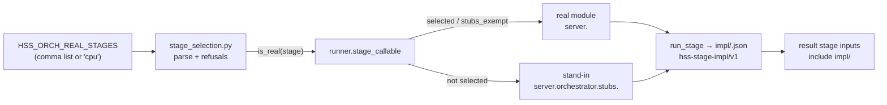

obv/burst14-bs-stage-selection — packet 3, burst 14 — mode: Autobuild (orchestrator worker thread)

## What changed

Until now, `HSS_ORCH_STAGE_STUBS=1` was all or nothing: a local run answered every stage with its stand-in from `server/orchestrator/stubs/<stage>.py`, so the result never depended on the scan and no real stage code could be exercised locally without running the full real orchestration (Modal, GPU, credentials). This change adds the middle setting and makes the choice observable:

1. **`HSS_ORCH_REAL_STAGES`** (new `backend/server/orchestrator/stage_selection.py`) names the stages whose **real** implementations run even with stage stubs on, per stage. A local or dev run can now exercise one real stage at a time against stand-in upstreams — e.g. `HSS_ORCH_REAL_STAGES=validate` runs the real packet validation and records which code served every other stage.
2. **Every stage publishes an implementation marker** at run-relative key `impl/<stage>.json` (stored at `captures/{capture_id}/runs/{run_id}/impl/<stage>.json`) under the pinned contract `hss-stage-impl/v1`, recording `implementation` (`real` or `stand-in`) and the exact dotted `callable` that executed — read off the resolved callable itself, so a per-run selection override (the capture-placement runner's) is recorded as what it ran, not what a global setting implies. Unset, behavior is byte-for-byte today's: every non-exempt stage records `stand-in`.
3. **The result stage's declared inputs include `impl/`** (`graph.py` `STAGE_INPUTS`), so the composer receives every marker of its run and downstream result consumers can name which implementation produced each input. The pinned contract is shared with `obv/burst14-bs-result-names-stand-ins`; it is defined once in `runner.py` (`IMPL_SCHEMA`) and copied verbatim there.

The `cpu` alias selects every stage whose real path is deterministic CPU work (no GPU, no model weights, no paid call): `validate poses reads scale coverage scene objects_3d placement criteria result`. `objects` is excluded because its real path loads OWLv2/SigLIP weights, and listing it is refused unless `HSS_OBJECTS_DEVICE=cpu` opts into local weights. `dense` is excluded because photo-only packets fall back to π³/MoGe/DA3 weights; it can still be listed by name. The alias is refused while `VISION_EXTERNAL_CALLS` is on, because `reads` and `criteria` would then call a paid vision model.

## Why

A per-run answer to "which code produced this?" needs two halves: the ability to run real stages locally at all (the selection), and a durable per-run record of what actually ran (the markers). The selection is dev-only by construction — refused together with a true `HSS_ORCH_MODAL_REMOTE` in any spelling `load_orch` accepts (a remote run already runs everything real) and unless `SMP_ENVIRONMENT` is exactly `dev`; unset or blank counts as prod, as it does in `Settings` — so production cannot silently run a half-real orchestration. Refusals raise at runner import, which is the startup of every process that can run a stage, and name the offending variable and value.

The markers land in `impl/` inside the run directory rather than in run metadata so they ride the existing artifact publication, hydration, and result-input machinery with no new transport, and survive in storage next to the artifacts they describe.

## How it works

Caption: the selection only changes which callable `stage_callable` resolves; the marker records what actually ran, and the result stage receives every marker.

## UI changes

N/A — orchestration backend only; no client-visible surface changes.

## Verification

- New: `backend/server/orchestrator/tests/test_stage_selection.py` — 14 tests: parsing (unset/blank, whitespace, `cpu` alias covering exactly `CPU_STAGES`, alias + `objects` = all 12), refusals (unknown stage, `HSS_ORCH_MODAL_REMOTE=1`, non-dev environment, `objects` without local-weights device — each message names the variable), the selection cache following the environment, callable selection under stubs (selected → real, unselected → stub, `stubs_exempt` placement stays real, stubs-off unaffected), runner-import-time validation of a bad value, and two in-process journey runs on the committed `backend/data/fixtures/packets/mini-arkit` packet: with `validate` selected the run reaches today's terminal state through the real packet validation with mixed impl markers (`validate` real/`server.packet.run`, `poses` stand-in, `placement` real via `stubs_exempt`), and unset the markers record exactly today's implementations; the result stage's hydration carries the whole `impl/` directory. No Modal, GPU, network, or credentials.
- `pytest server/orchestrator/tests` — 195 passed.
- `pytest backend/tests/test_capture_real_downstream.py` — 12 passed (the #292 capture-real-downstream journey, which overrides `stage_callable` per run, is unchanged and its override is what the marker's callable field is designed to record honestly).
- `pytest backend/tests/test_runtime_join_journey.py` — 6 passed.
- `ruff check .` — clean; the new test file is `ruff format`-clean.
- Full `make test` — 4 failed, 1520 passed, 19 skipped, 14 errors in 10:43: the failure set is the branch base's documented baseline exactly — 4 `server/eval/tests/test_gates.py` (SD-96 gates) failures plus 14 collection errors in `tests/test_capture_cold_restart.py`, every name in files this branch does not touch; zero failures attributable to this change.
- Coverage limit: the `objects` real path with local weights is refused-by-default and not exercised end-to-end here (no weights on the dev box); the refusal itself is tested.

## Risk

- A real stage fed by stand-in upstreams can meet inputs it was not built for (the stub poses stage produces a single identity camera, for example); the docs (`backend/docs/real-cpu-stages.md`) name this and recommend selecting upstream stages together. This is a dev-only knob and fails at run time, not silently.
- `impl/` artifacts are new keys under the run directory; only the result stage's declared inputs change, and `_publish` callers treat unknown keys uniformly. Runs that fail a stage publish no marker for it, same as any other artifact.
- Pre-existing on `alpha`, untouched here: `ruff format --check` flags `server/orchestrator/tests/test_greptile_followup.py`; `make lint` will report it on the base branch too.

## Checklist

- [x] The scope is focused; related changes belong together
- [x] I explained what changed and why
- N/A — no visible changes (backend orchestration only; before/after images not applicable)
- N/A — no motion or interaction changes (no video applicable)
