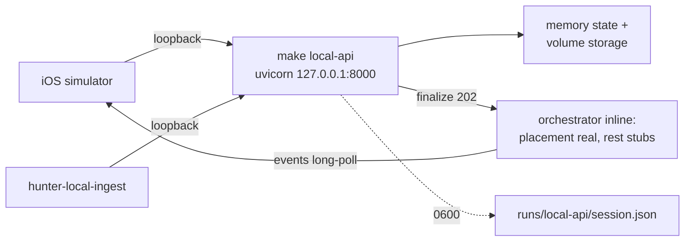

Backend: one command serves the capture API locally

🔗 [Obvious Project](https://app.obvious.ai/p/products-Uu1863v1) · 🧵 [Obvious Thread](https://app.obvious.ai/p/products-Uu1863v1?thread=th_EJ3OQm7V) · 🔀 [Obvious PR Artifact](https://app.obvious.ai/link/pr-artifact/backend-one-command-serves-the-capture-api-locally-task:todo_vjwmwyTp)

Human author: Sam Gu (sgu07966@gmail.com)

## What changed

`make local-api` in `backend/` now serves the real capture API for local iOS
development and harness runs:

- `scripts/local_capture_api.py` (new, 228 lines): binds loopback only
  (refuses any other host), configures the dev stack in-process — memory
  state, volume storage, `HSS_INGEST_HOOKS=auto`, `HSS_ORCH_STAGE_STUBS=1`
  with `placement` real — generates fresh app and reviewer bearer tokens per
  run, and writes `backend/runs/local-api/session.json` (mode `0600`,
  gitignored) holding the pinned session shape the iOS run reads:
  `appToken`, `baseUrl`, `gitSha`, `pid`, `reviewerToken`, `stageStubs`,
  `startedAt`. The banner reports the URL, session path, stand-in stage list,
  and that tokens live only in the session file — never stdout. Ctrl-C stops
  everything.
- `Makefile`: `local-api` (the one command; `PORT ?= 8000` with an
  empty-env-value guard) and `local-api-smoke` (the suite below).
- `tests/test_local_capture_api.py` (new, 368 lines): starts the launcher as
  a subprocess on an ephemeral port and drives the committed mini-arkit
  packet over real TCP with httpx — create, signed PUT uploads, commit,
  finalize 202, then event long-polls to terminal `manual_review` with nobody
  calling `drain_finalize`. Also pins: the result not-ready envelope
  (200 pre-run) and the reviewer-page 404 `result_not_ready` (which needs the
  reviewer bearer — the reviewer gate runs before the not-ready check), the
  malformed-finalize 4xx, missing/wrong bearer 401s, tokens never appearing
  in launcher logs, and non-loopback host refusal.
- `docs/local-capture-api.md`: fresh-checkout setup, environment choices,
  simulator (shared loopback) vs physical-device (not reachable) note, and
  pointing `hunter-local-ingest` at the local API.
- `docs/evidence/local-capture-api/`: recordings and screenshots of the live
  run (see Verification).

## Why

The iOS app and the ingest harness both need a real HTTP surface — signed
upload PUTs, TCP event long-polls, and the device-facing result boundary —
without a cloud deployment or hand-assembled environment variables. One
command plus one session file replaces tribal setup knowledge, and the smoke
target makes "is the local stack healthy" a two-minute check.

## How it works

One process serves API, auth, uploads, and the inline orchestrator run; the
session file is the only token carrier.

## UI changes

No product UI changed. The developer-facing review page served by the local
stack renders the dev stub (compose is a stand-in locally); screenshot in
`docs/evidence/local-capture-api/review-page.png` alongside the device-facing
result envelope (`result-page.png`).

## Verification

All checks run on a fresh clone of `alpha` at `4bcbedba` (uv 0.13.1, Python
3.12.15); nothing is suggested-only.

- `make local-api-smoke`: **6 passed**, three consecutive runs from a clean
  `runs/` (6.5s each). The journey reaches terminal `manual_review` over a
  real socket with the placement stage real and nobody draining finalize.
- Live run recorded: `make local-api` from a clean `runs/` (banner in
  `local-api-terminal.png`, full cast `local-api.cast`), then the committed
  smoke-test helpers driven against port 8000 — capture
  `cap_01M51TS13336P96H5B6KFPH9WW`, run `run_4c05e7d782dfc5f5`, outcome
  `manual_review` ("Review required before a placement is shown."), receipt
  `live-journey-receipt.json`. Playwright screenshots of the review page
  (reviewer bearer) and result envelope (app bearer) attached; committed
  evidence blobs scan-clean for both session tokens.
- Launcher contract pinned by tests: session file mode `0600`, exact key set,
  distinct 40+ char tokens, `baseUrl` host:port only, pid liveness,
  non-loopback refusal, tokens absent from logs.
- `ruff check` + `ruff format --check` clean on both new files.
- Full `make test`: 4 failed, **1431 passed**, 19 skipped, 14 errors in
  12:37. The 4 failures (`server/eval/tests/test_gates.py`, expired SD-96
  gates) and the 14 errors (`tests/test_capture_cold_restart.py`,
  `ImportError: cannot import name 'load_receipt' from
  'scripts.replay_capture'`, commit `d7becb7c`) both reproduce on pristine
  alpha `4bcbedba` — verified via a detached worktree — and are not caused by
  this branch, which touches no existing module.

Coverage limits: physical-device reachability is documented but untested
here (no device); compose stays stubbed, so the review page is the dev stub;
no Windows path handling (loopback bind is POSIX/macOS-oriented).

## Risk

- Low: everything is additive; no existing module changed (Makefile gains
  two targets plus the PORT guard). The empty-`PORT` guard exists because an
  exported-but-empty `PORT` env var otherwise breaks the arg — benign on a
  normal Mac.
- The smoke suite binds ephemeral localhost ports; parallel CI runs are safe.
- Out of scope: the alpha-shipped cold-restart import error and the expired
  SD-96 gates predate this branch and need alpha-side fixes.

## Checklist

- [x] The scope is focused; related changes belong together
- [x] I explained what changed and why
- [x] I included before/after images for visible changes — N/A for product
  UI (none changed); developer-facing captures included in docs/evidence
- [x] I included a video for motion or interaction changes — N/A, no
  interactive UI changed; terminal recordings (.cast) included instead
