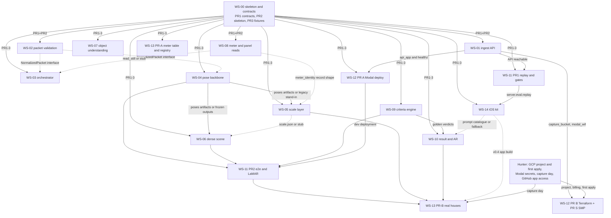

---
cursor:
  subagentId: "bc-16148192-6376-5cfd-b256-a5f153091d5b"
---

# Builder briefs: index, dependency order, shared conventions, kickoff templates

2026-09-26 22:45 UTC. Store root `$S` = `/cursor/stores/bc-5bc79926-909c-4cfb-aa62-24b3a44735e2`. Repo `huntertcarver/house-scanning-server`. Master plan: `$S/docs/server-pipeline-build-plan.md`. Brief template: `$S/internal/build/brief-template.md`; every brief has its 13 sections in order (Card, Start gate, Files, Interfaces, Behaviour, Reuse, Fixtures, Commands, Done when, Validator checklist, Constraints, Out of scope, Open questions).

Precedence when texts disagree: `$S/internal/build/seam-decisions.md` (ids `SD-nn`) > the group decision log > the brief > the master plan. Measured breadth reports beat all prose (`$S/internal/breadth/*.md`, `$S/internal/modal-pipeline/benchmark.md`).

Read order for any agent joining a workstream: (1) this README, (2) `$S/internal/build/seam-decisions.md`, (3) the group decision log (`$S/internal/build/decision-log-group-<a|b|c>.md`, group letter in §1), (4) the brief, (5) the contract docs the brief cites (`$S/docs/capture-packet-spec.md`, `$S/docs/scene-and-verdict-format.md`, `$S/docs/hosted-architecture.md`, `$S/docs/criteria-spec.md`).

## 1. Brief index

| WS | Brief (`$S/docs/build/`) | Group | One-line scope | PRs (branches `ws-XX/<kebab>`) |
|---|---|---|---|---|
| WS-00 | `ws-00-skeleton-and-contracts.md` | A | `server/` package skeleton, one typed contract package (pydantic v2 + JSON Schema) for every artifact that crosses a workstream boundary, golden fixtures behind `make validate`, CI jobs `contracts` and `fixtures`; decides names, units, frames and gates, never an algorithm | three, in order: `ws-00/contracts`, `ws-00/skeleton`, `ws-00/fixtures` |
| WS-01 | `ws-01-ingest-api.md` | A | the `/v1` FastAPI (captures, per-file signed-URL upload, commit, finalize, events long-poll, status, result, amendments, confirmations, devices, delete, healthz) as a Modal asgi app; `Storage` backends GCS (Modal OIDC → WIF, keyless V4 signing), R2, volume; state `modal.Dict` now, Postgres later; Terraform modules `capture_bucket`, `modal_wif` | `ws-01/ingest-api`, then `ws-01/multipart` |
| WS-02 | `ws-02-packet-validation.md` | A | finalized packet → `ValidationReport` with RFC 6901 pointers (the 422 body), `NormalizedPacket` (intrinsics for every image, one JPEG per image, re-orthonormalized epoch-grouped poses, tier/branch/flow), the `capture_check` checklist with the shared code list | `ws-02/packet-validation` |
| WS-03 | `ws-03-orchestrator.md` | A | the eleven stages on Modal (`.spawn()` per stage, heartbeats, 5-min sweeper, GPU escalation on the third attempt, 20-min hard stop), early workers at file commit (reads, QA + gate scores, pose-frusta `capture_check`), prewarm at capture creation, `stage`/`hint`/`capture_check`/`failed` events, the failure-to-outcome table; builds `Pipeline`, WS-12 deploys it | `ws-03/orchestrator` (+ additive `ws-03/contracts-jobs-ext`) |
| WS-04 | `ws-04-pose-backbone.md` | B | COLMAP incremental SfM with tight ARKit position priors (σ 0.03 m, no robust loss, spatial 40 / 20 m + sequential 10) in the guided flow, image-only incremental SfM in the photo flow; SfM frame budget 48 keyframes, the rest registered fixed-ARKit or via the image registrator; epochs, fragments, fixed-ARKit fallback, meter bridge check, `registration_report.json`; port source is the A1/A6 recipe, not housepipe's SfM path | `ws-04/pose-backbone` |
| WS-05 | `ws-05-scale-layer.md` | B | metres with a stated 95 % bound: LiDAR similarity alignment when depth + confidence exist, else the meter's exact make/model cover diameter measured in the two close-ups (identity handed over by WS-08), ARKit session scale as a gate, doors/garage/footprint as checks only; `scale/scale.json`; the dimension table is WS-13's `data/meter-models/meter_models.v1.json` (WS-05 owns only the loader); the meter term is implement-and-validate work, never a port | `ws-05/contracts-scale-ext`, then `ws-05/scale-layer` |
| WS-06 | `ws-06-dense-scene.md` | B | metric dense cloud (π³ 8–16-view windows, or LiDAR TSDF within 5 m), fog-of-war coverage grid + bands under the §3.1 rule with depth-aware occlusion, validated `base-scene/v0` anchored at the meter, wall completion from ARKit plane anchors kept `unobserved`; stages `dense` (GPU), `coverage`, `scene`; `merge_objects` | `ws-06/dense-scene` |
| WS-07 | `ws-07-object-understanding.md` | C | CLIP ∪ SigLIP gate (top-2 frames per equipment class), OWLv2 + GDINO proposals, GPT-5.4-mini screen → GPT-5.5 confirm → Grok 4.7 second read on decision-bearing objects, no crops (stage `objects`, 2D, parallel with `poses`); 3D placement per tier after `scene` (stage `objects_3d`: LiDAR lift, taps and wall casts, `location_unsure`); ≤ $0.85 VLM per house, expected $0.27–0.41 | `ws-07/object-understanding` |
| WS-08 | `ws-08-meter-panel-reads.md` | C | meter nameplate (number, form, class label, CL320, make/model for WS-05) and panel reads (brand, amps, recall, condition): GPT-5.5 + Grok 4.7 in parallel at 2048 px, zxing barcode confirm, panels GPT-5.4-mini first then GPT-5.5 escalation, hazard `confirmed` only when both flag, one-tap pre-fill instead of auto-fill; contract-valid `fact` items; early worker | `ws-08/meter-panel-reads` |
| WS-09 | `ws-09-criteria-engine.md` | C | one contract-valid verdict per profile A/B/C/S: C1 rules-3d (`engine3d.py`) decides, the PR #11 single-chain solver decides the meter-wall chain where the 3D engine is unsure and the chain's inputs are observed, C2 volumetric vetoes, C3 downgrades only; coverage evidence on every measurement, C5 margin, both-ends rule, `views_needed`, candidates and the chosen spot | `ws-09/criteria-engine` |
| WS-10 | `ws-10-result-and-ar.md` | C | verdict + scene + reads → the device result (`ResultResponse` with the `outcome` block), AR anchors in ARKit world via the inverse of `frame.from_source`, customer copy from WS-14's catalogue, meter pre-fill block, `verdict_ready`/`retake_request` with APNs and Base-webhook payloads, read-only reviewer HTML | `ws-10/result-and-ar` |
| WS-11 | `ws-11-eval-and-regression.md` | A | replay client (the iOS stand-in), `gates.yaml` + the gate table every PR pastes, `make e2e`/`e2e-local`/`gates-offline`, `run-c1` → `run-hs11`, real-engine `run-criteria`, `pass_recall`, safety rows, LaMAR real-phone runner | `ws-11/replay-and-gates`, then `ws-11/e2e-and-lamar` |
| WS-12 | `ws-12-deploy-and-infra.md` | A | one Modal app `house-scanning` per environment deployed from CI, `Dockerfile` for the GPU image, Terraform root stack on the decided GCP layout, promotion and rollback by pinned SHA, JSON telemetry + cost report, dispatch-only GPU bench, GCP migration notes | `ws-12/deploy-modal` (A), `ws-12/infra-terraform` (B), SMP `house-scanning/substrate-onboarding` (S) |
| WS-13 | `ws-13-real-house-and-data.md` | B | two real houses on a non-Pro iPhone in both flows plus one LiDAR session each (R1 expected pass under A and C, R2 expected reject) with team laser/tape truth; meter dimension table v1 with per-number provenance; blind labels (the first `pass` labels in the dataset); registry and three more YouTube packets; LaMAR fetchers; evidence register and fold-ins | `ws-13/meter-models-and-registry` (PR-A), `ws-13/real-house-and-data` (PR-B) |
| WS-14 | `ws-14-ios-contract.md` | C | `ios-kit/`: schemas, example packets and results, three mini fixtures, the customer-facing prompt catalogue, a default for every open iOS question, `ios_kit replay` wrapping WS-11's engine, a contract fake, the spec change process | `ws-14/ios-contract` |

Groups are the applier groups whose decision logs live at `$S/internal/build/decision-log-group-a.md` (WS-00, 01, 02, 03, 11, 12), `decision-log-group-b.md` (WS-04, 05, 06, 13) and `decision-log-group-c.md` (WS-07, 08, 09, 10, 14). `seam-decisions.md` §9's last line names "group B" for WS-04…WS-10, WS-13, WS-14: read that as groups B and C. A log that has not landed means the brief on disk is current for that group.

## 2. Dependency graph

Edges are start gates as written in each brief's §1 (solid = merged code or artifact required; dotted = a typed interface or an accepted stub is enough).



## 3. Start-gate order

A wave starts when its gate PRs are merged on `main`, not when they are opened. Builders that find a gate item missing stop and report (brief §1); they never stub another workstream's deliverable unless their brief names the stub.

| Wave | Gate | Workstreams | Notes |
|---|---|---|---|
| 0 | repo `main` green (`lint`, `test`); Cursor GitHub app on the repo or the Mac-sync push path | WS-00 | a stronger model than Grok 4.7 may take WS-00 (the brief is model-agnostic); it fixes every shared name, so nothing else starts before its PR 1 |
| 1 | `ws-00/contracts` + `ws-00/skeleton` merged | WS-01, WS-02, WS-08 | WS-08 needs only the `server/reads/` stub, the two API keys and the B2 photos |
| 2 | `ws-00/fixtures` merged (`make validate` green) | WS-04, WS-07, WS-09, WS-13 PR-A, WS-14 (schemas, examples, minis, catalogue, fake; the replay wrapper waits for wave 5) | WS-04 and WS-07 start on GT-scene keyframes and fixture packets; WS-09 needs the `eth3d-delivery` GT rebuilt (`build_gt_c2.py`) |
| 3 | WS-02 typed interface on `main` (or the accepted stubs); WS-01 API reachable with `GET /v1/healthz` → 200 | WS-03, WS-11 PR1, WS-12 PR A | WS-03 runs all eleven stages from stubs (`HSS_ORCH_STAGE_STUBS=1`) until the real stages land; WS-12 PR A may ship with the API and `smoke_cpu` only |
| 4 | WS-04 merged (or frozen `poses/` outputs from WS-00/WS-11); WS-08 merged (or the `meter_identity` record shape agreed) | WS-05, WS-06 | WS-06 may run with WS-05's stub `scale.json` |
| 5 | WS-09 golden verdicts (`make criteria-golden`); WS-11 PR1 merged | WS-10, WS-14 replay wrapper | WS-10 uses WS-14's catalogue or the test-only fallback table |
| 6 | WS-04 + WS-06 + WS-09 on `main`; WS-12 PR A `dev` deployment answering healthz | WS-11 PR2 | LaMAR runner ships with `SKIP` if the download fails |
| 7 | WS-01 modules merged; GCP project `house-scanning` created, billing linked, APIs enabled and the first `terraform apply` run by Hunter (else the fallback path: own pool + `hss-tfstate`) | WS-12 PR B, PR S | PR S needs write access to `huntertcarver/Software-Manufacturing-Plant`, else Hunter applies the diff |
| 8 | WS-11 PR2 green on `eth3d-facade` against `dev`; WS-04/05/06/09/10 merged; capture day scheduled with a non-Pro and a LiDAR iPhone; iOS v0.4 app build (else the §4-C0 fallbacks) | WS-13 PR-B | R1 (expected pass) and R2 (expected reject) are both required; a pass-site-only WS-13 is not done |

Milestones: M0 = waves 0–3 (a fixture packet flows through the API and the orchestrator to a stub verdict), M1 = waves 4–6 (real verdicts on the golden sites, 0 unsafe passes, the gate table in CI), M2 = waves 5–7 (objects, reads, result + AR payload, deployed on Modal with measured timings), M3 = wave 8 (two real houses, iOS end to end, thresholds recalibrated).

## 4. Shared conventions

Copied from `$S/internal/build/seam-decisions.md`; the `SD-nn` ids point at the full rows. Where a brief still says otherwise, the seam file wins and the group log records the edit.

### 4.1 Names: storage keys, stage folders, ids (SD-01…SD-09)

- Storage: packet files `captures/{captureId}/{path}` after promotion; signed PUTs target `uploads/{captureId}/{path}` (7-day lifecycle `Delete` on `uploads/`, never on `captures/`); finalize body `captures/{captureId}/packet.json`; amendments `captures/{captureId}/amendments/{aid}/{path}`; early-worker blobs `captures/{captureId}/early/{reads/<stillId>.json, qa/<frameId>.json, meter_identity.json, capture_check.json}`; run artifacts `captures/{captureId}/runs/{runId}/<stage-folder>/<file>`. Attempt folders (`work_dir/_attempts/<stage>/attempt-<n>/`) are local only; a later successful attempt overwrites; readers follow `RunRecord.artifacts` (SD-01, SD-30).
- Stage folders and files: `packet/{validation.json, normalized.json, capture_check.json}` (transcoded stills at `captures/{captureId}/normalized/stills/<id>.jpg`); `poses/{cameras.json, sparse.ply, tracks.npz, registration_report.json, sparse/0/, fragments/<k>/, database.db}`; `scale/scale.json` (`ScaleBlock` + `scale_factor`, `origin_m`; WS-06 copies it to `scene/scale.json` and mirrors it at `provenance.producer.params.scale`, no scene schema change); `dense/{dense.ply, flagged.ply, depth/<keyframeId>.npz, dense_report.json}`; `coverage/{coverage.npz, bands.json, points.ply, scene_draft.json, coverage_report.json}`; `scene/{scene.json + every referenced asset, build_report.json, coverage_topdown.png, preview.ply?}`; `objects/objects.json` (`hss-objects/v0`, 2D detections with `views[]`, before `scene`) and `objects/objects_3d.json` (`hss-objects-3d/v0`, scene-frame `Object`s, after `scene`, merged by `server.scene.merge_objects`); `reads/reads.json` (`base-reads/v0`); `verdicts/{verdict.{A,B,C,S}.json, criteria_report.json, placement.<profile>.json, c1.<p>.raw.json, c2.sweep.json, c3.facts.json, c3.judge.json}`; `result/{result.json, result.internal.json, review.html, preview.ply}`; `run/{timings.json, cost.json, stages.json}`. Never `normalized_packet.json`, `validation_report.json`, `poses/poses.json`, `poses/registration.json`, `poses/model/`, or flat keys (SD-02…SD-07).
- Stages: `StageName` = `validate, poses, objects, reads, scale, dense, coverage, scene, objects_3d, criteria, result` (11). Deps: `poses, objects, reads ← validate` (parallel); `scale ← poses, reads`; `dense ← poses, scale`; `coverage ← dense`; `scene ← coverage, objects(terminal)`; `objects_3d ← scene, objects` (optional, CPU, 120 s); `criteria ← scene, reads(terminal), objects_3d(terminal)` after `merge_objects`; `result ← criteria`. Optional stages `objects`, `reads`, `objects_3d`. `EarlyJobName = early_reads | early_qa | capture_check`. Entry point for every stage `server.<stage>.run(ctx: StageContext) -> StageResult` (`objects_3d` = `server.objects.run_3d(ctx)`); failures are raised (SD-08, SD-24).
- Ids: `captureId = "cap_" + ULID`; `run_id = "run_" + sha256(packet.json bytes as stored)[:16]` (amendment runs hash the amendment packet); `confirmationId = "cfm_" + ULID`; `amendmentId` is the client's; events keyed by `seq` (SD-09).
- SfM frame budget: `HSS_POSES_SFM_MAX_FRAMES=48` keyframes for the mapper, the rest registered fixed-ARKit or through the image registrator; `poses` stage timeout 420 s (SD-10).
- Orchestrator entry points: `start_run(capture_id, packet_sha256, packet_uri, *, parent_run_id=None) -> RunRecord`, `prewarm(capture_id, *, tier, expected_keyframes=None)`, `dispatch_early(capture_id, files: list[CommittedFile])`, `on_confirmation(...)`, `cancel_capture(capture_id)`, `sweep() -> int`, re-export `validate_manifest` from `server.packet.validate` (SD-23).
- `capture_check` codes (`CaptureCheckCode`, 16): `meter_close, meter_oblique, meter_closeups_in_session, meter_tap, door_view_meter_side, panel_close, panel_open, main_disconnect, keyframe_count, keyframe_cadence, tracking_quality, photo_count, wall_left_of_meter, wall_right_of_meter, ground_downward_left, ground_downward_right`. `HintCode` = those 16 + `frames_blurry, frames_dark, frames_overexposed, wall_gap_left, wall_gap_right, ground_not_seen_left, ground_not_seen_right` + WS-08's read-hint codes. No `ground_downward_<wallId>`, no `cc.*` (SD-20).
- Events: `EventType` = `files_committed, hint, capture_check, stage, verdict_ready, retake_request, review_started, review_completed, failed, confirmation` (10); typed camelCase `data` per SD-19; `verdict_ready`/`retake_request` are emitted by the `result` stage, the coordinator verifies exactly one final event per run.
- Confirmations: `POST /captures/{id}/confirmations` `{fieldId: meter_number|panel_brand|main_breaker_amps, kind: confirmed|corrected|none, value?, imageId, clientAt}` → `201 {confirmationId, fieldId, imageId, kind, receivedAt, seq}`; replay 200; 409 `confirmation_conflict` / `capture_closed`; 422 `value_required` / `image_unknown`; `GET …/confirmations` (SD-21).
- `flow: guided|photo` (never `photos`); absent → `guided` for ARKit tiers, `photo` for `photo_only`. `formatVersion` must be `"0.4"`; code `format_version_unsupported` (422) on create and finalize (SD-22).
- `GET /v1/healthz {status, storage, state, wifTokenExpiresAt, version}` with `version = GIT_SHA[:12]` (SD-36). Web endpoint label `house-scanning-capture-api`; one deployed Modal app `house-scanning` per environment composed in `server/modal_app.py` (SD-32).

### 4.2 Environment variables (SD-11…SD-13)

- Platform names, bare, only in WS-00 `Settings`: `SMP_PRODUCT_ID, SMP_ENVIRONMENT, SMP_SERVICE_NAME, STORAGE_BACKEND, STATE_BACKEND, STATE_DICT_NAME=hss-<env>-state, GCP_PROJECT_ID, GCS_BUCKET, GCP_RUNTIME_SA_EMAIL, GCP_WIF_AUDIENCE, GCP_AUTH_MODE=wif|adc_impersonate|sa_key, VOLUME_ROOT, CAPTURE_API_PUBLIC_URL, R2_ACCOUNT_ID, R2_BUCKET, R2_ACCESS_KEY_ID, R2_SECRET_ACCESS_KEY, OPENAI_API_KEY, XAI_API_KEY, CAPTURE_API_TOKENS, UPLOAD_URL_HMAC_SECRET, WEBHOOK_HMAC_SECRET, BASE_WEBHOOK_URL, DATABASE_URL, APNS_KEY_P8, APNS_KEY_ID, APNS_TEAM_ID, GIT_SHA`.
- Shared pipeline knobs, bare, WS-00 `Settings`: `RULES_PROFILE_DEFAULT=C, SHOW_REJECT_TO_HOMEOWNER=false, GROUND_RULE_DEFAULT=angle80, HARD_STOP_MIN=20, CAPTURE_CHECK_TARGET_S=30, VISION_EXTERNAL_CALLS=on|off` (default `on` in dev, required explicit in prod), `FIXTURE_SOURCE, FIXTURE_CACHE=.fixtures`.
- Every per-area knob is `HSS_<AREA>_*`, AREA ∈ `INGEST, AUTH, ORCH, PIPELINE, API, POSES, SCALE, DENSE, COVERAGE, SCENE, OBJECTS, READS, CRITERIA, RESULT, EVAL`. Renames applied to the briefs: WS-03 `HSS_HEARTBEAT_S…` → `HSS_ORCH_*`; WS-01 `HSS_HOOKS` → `HSS_INGEST_HOOKS`, `HSS_GCP_AUTH_MODE` → `GCP_AUTH_MODE`, `HSS_STATE_DICT_NAME` → `STATE_DICT_NAME`; WS-08 `READS_*` → `HSS_READS_*`; WS-07 `OBJECTS_*` → `HSS_OBJECTS_*`; WS-05 `SCALE_*` → `HSS_SCALE_*`; WS-12 `HSS_ENV` → `SMP_ENVIRONMENT` at deploy time. No `HSS_STATE_BACKEND`.
- `Settings(BaseSettings)` fails fast at construction; `server.common.config.load() -> Settings` is the one factory; values are never logged (SD-12).
- Logs: one JSON line per event with the WS-00 key set `ts, level, event, msg, service.name, deployment.environment, product, git_sha, request_id, capture_id, run_id, stage, attempt, gpu, duration_ms, vlm_provider, vlm_model, tokens_in, tokens_out, vlm_cost_usd, disagreement, error_code` plus WS-01's HTTP fields; WS-12's `telemetry.py` builds on it, never a second logger (SD-13).
- Modal Secrets (names only): `hss-<env>-vlm` (`OPENAI_API_KEY`, `XAI_API_KEY`), `hss-<env>-api` (`CAPTURE_API_TOKENS`, `WEBHOOK_HMAC_SECRET`, `UPLOAD_URL_HMAC_SECRET`), `hss-<env>-gcp` (`GCP_*`, `GCS_BUCKET`, `STORAGE_BACKEND`, `STATE_BACKEND`, `STATE_DICT_NAME`), optional `hss-<env>-r2`, later `hss-<env>-db`, `hss-<env>-apns` (SD-32). Deploy-time knobs `HSS_PIPELINE_MIN_CONTAINERS` (1 during demo windows or when the warm-hit rate is below 80 %), `HSS_PIPELINE_MAX_CONTAINERS`, `HSS_PIPELINE_GPU`, `HSS_API_MIN_CONTAINERS` (SD-32, SD-33).

### 4.3 Casing (SD-25…SD-27)

- camelCase for everything on the wire: packet, API bodies, event `data`, the whole `ResultResponse` including `outcome`. snake_case for Python identifiers and internal files (scene, verdict, labels, scale, jobs records). The only snake_case on the wire is an embedded verbatim `verdict` document, optional and off by default.
- Result schema lives only in `server/contracts/result.py` + `schemas/result.v0.schema.json`. `Outcome {kind, profile, message, arkitEpoch?, frameToArkit?, recommendedPlacement?, cableRoutePolylineArkit?, viewsNeeded: list[ViewNeededDevice], reasons: list[RejectReason]}`; `RecommendedPlacement {wallId, startSM, footprintM {w,h,d}, boxSceneM {centerM, sizeM, yawDeg}, boxArkitWorld? {pose, size}, confidence, profile}`; `RejectReason {criterion, measuredFt?, plusMinusFt?, thresholdFt?, comparison?, text, evidence {images, boxesPx}}`. The envelope's `viewsNeeded` and `outcome.viewsNeeded` are the same objects.
- `ViewNeededDevice {id, kind, band?, wallId?, sM?, outM?, side?, target?, criteria, why, viewingAngleDeg?: [min, max], promptId, prompt {title, body}, targetRegionArkit? {surface: wall|ground|free, polygon}, suggestedCameraPoseArkit?, referenceCrop? {image, boxPx}}`. Verdict v0 `views_needed[]` gains optional `view_angle_deg: [min, max]` by spec PR; until merged WS-10 derives the band (`band: wall` → `[0, 30]`, `ground` → `[20, 60]`). No `prompt` in the verdict.
- Contract models: `ValidationIssue`/`ValidationReport` in `server/contracts/validation.py` (no `PacketReport`); one `StateStore` and one `Storage` protocol in `server/common` with backends under `server/common/backends/`; `RunRecord`, `StageRecord`, `EventRecord`, `CommittedFile`, `StageContext` shapes per SD-14…SD-17; `CaptureRecord.status` is the single device-visible status (SD-18).

### 4.4 Fixtures (SD-28, SD-29)

- Layout is WS-00 D-15: `data/fixtures/scenes/<site>/gt-laser/`, `.fixtures/gt/<site>/gt-laser/{laser.ply, occluders.ply}`, `data/fixtures/labels/`, `data/fixtures/verdicts/`, `data/fixtures/reference-scores/`, `data/fixtures/packets/<house>/packet.<variant>.json`, `.fixtures/packets/<house>.tar` (+ extracted `<house>/`), `data/fixtures/packets/examples/`. Never `data/fixtures/gt/`, `$HS_FIXTURES`, `data/labels/`. `make fixtures ONLY=small|large|all`, `make fixtures ITEM=<manifest id>`.
- Stills fixtures: `yt-12Ks1idWj40` (the only store packet with stills; 4.4 MB tar) is the sixth fetched house; `yt-0gotY_syWWU`, `yt-4h8kyjnPo9s`, `yt-5-M-7f35Tyg` are fetch-only items with committed manifests (WS-02's 33-packet gate); WS-00 commits the synthetic `data/fixtures/packets/mini-arkit/` (≈ 60 KB from `example-packet.json`: 4 keyframes, `s1` `meter_close`, `s2` `meter_oblique`, the `meter` tap, one door view) as the shared ARKit-with-meter-stills fixture. `yt-12Ks1idWj40` stays excluded from placement scoring and from `e2e_packets`.
- No tracked file over 5,000,000 bytes; tars, PLYs and weights are fetched into `.fixtures/` or live on the Modal volume. ETH3D (CC BY-NC-SA) and YouTube frames stay in the private repo, evaluation only.
- Positive-pass truth: chain `s` in metres from the meter (facade C under `footprint3in`: `start_s_m ⊂ [-3.891, -3.383]`, route ≤ 9.0 ft), run on the gravel-patched facade GT derived at test time (SD-39).

### 4.5 CI gates (SD-37, SD-40…SD-42, WS-00 §8, WS-11 §3.3)

- Every PR keeps green: `make validate`, `make schemas` (`export_schemas --check`), `make hygiene` (5 MB limit, deny-list `SSR_Prompts.md`, `ssr-quick-reference-notion.md`, `meter_numbers_hand.csv`, `hand_numbers_raw.txt`, `*.tar`, `*.tar.part-*`, `*.7z`, `.env`, `*.p8`; key patterns `sk-…`, `xai-…`, `AKIA…`, `BEGIN PRIVATE KEY`), `uv run lint-imports` (stage packages never import each other), `score-verdicts` on the reference verdicts with 0 unsafe passes, and `make gates-offline` (WS-11 fixture rows: `unsafe_passes 0`, `false_rejections 0`, `coverage_contract_errors 0`, `c5_margin_errors 0`, positive-pass rows, `no_coverage_no_pass`, `bounds_honest`, `veto_monotone`, `judge_monotone`).
- Ownership: WS-00 `lint`, `test`, `contracts`, `fixtures`; WS-11 `gates-offline` and `.github/workflows/e2e.yml` (nightly `17 6 * * *`, `e2e_packets` = `eth3d-facade:arkit-lidar`, `eth3d-facade:arkit-nonlidar`, `eth3d-electro:arkit-nonlidar`); WS-12 `deploy.yml`, `gpu-bench.yml` (dispatch only), `infra.yml` (dispatch only, `apply=true` explicit) and the `ci.yml` jobs `terraform`, `modal-check`, `workflows-lint`.
- Nightly e2e gates: facade `arkit-lidar` `by_wall.w1.p90_in ≤ 3.0`, `false_observed_claims == []`, `|scale_error_pct| ≤ 1.0`; facade `arkit-nonlidar` `by_wall.w1.p90_in ≤ 5.5`; electro `on_truly_observed_elements.p90_in ≤ 6.0`; every verdict validates and scores 0 unsafe passes; `capture_check` within 30 s of the last commit; `time_to_verdict_p50_s_max: 180` against packets thinned to ≤ 48 SfM frames; whole run ≤ 10 min. Event order `validate → {poses, objects, reads} → scale → dense → coverage → scene → objects_3d → criteria → result`.
- Weekly LaMAR real-phone gate: `openings_p90_in_max: 4.6` over the five segments (measured 2.8 / 4.1 / 3.9 / 4.2 / 3.9 in reported as is); a segment registering < 60 % of frames is a FAIL row.
- Decidability: the share of candidate × criterion cells decided (pass or fail) is reported per site next to unsafe passes; E2E baseline on photos facade 12–13 %, electro 24–25 % (laser 38 % / 75 %); no floor until Base sets a review-rate target.
- Harness CLI: `run-c1` → `run-hs11` everywhere; `run-criteria` wraps `server.criteria.run.evaluate_scene` with `CriteriaConfig` fields `profiles, ground_rule, c2, c3` (SD-41).
- Toolchain `[provisional: WS-04]`: `pycolmap==4.2.0` repo-wide with the COLMAP CUDA build bumped to the release the 4.2.0 wheel targets (never a 3.11.1 binary with 4.x pycolmap); Python 3.12; the ~609 s image compile is prebuilt and pinned by WS-12. If WS-04 proves the 3.11.1 path reproduces A6 within tolerance, the pin reverts in a one-line PR (SD-34). WS-04's port source is the A1/A6 recipe; `housepipe/colmap_prior.py` stays reference only (SD-35).

## 5. Kickoff prompt templates

Fill the angle-bracketed fields; keep the rest verbatim. Both templates assume the store is mounted at `$S` (or Mac-synced) and a clean clone of the repo.

### 5.1 Builder (Grok 4.7)

```
You are the builder for <WS-XX name> in huntertcarver/house-scanning-server.
Read, in this order, before writing any code:
  1. $S/docs/build/README.md (this file; §4 conventions win over brief text)
  2. $S/internal/build/seam-decisions.md (every SD-nn row that names your WS)
  3. $S/internal/build/decision-log-group-<a|b|c>.md (your group's applied decisions; if absent, the brief on disk is current)
  4. $S/docs/build/<brief file>, every section
  5. the contract docs your brief cites under $S/docs/
Check the start gate (brief §1). If any item is missing, stop and report; never invent it.
Branch: <ws-XX/kebab-name> (the Card's branch; one PR unless the Card says otherwise).
Own only the files in brief §2. Never edit $S/docs/*, $S/internal/**, or another workstream's package; put inconsistencies in your component page and your reply.
Build to brief §4 with the §3 interfaces, reuse per §5 (drop every Anthropic branch and pooled key name), run every §7 command, and paste the §8 "Done when" table with observed values into the PR. Write docs/components/<ws-XX-...>.md from WS-00's template. List every [default chosen] you add in $S/internal/build/layout-decisions-<ws>.md (report only; the coordinator files it if you cannot write the store).
Constraints: vision models GPT-5.5 and Grok 4.7 only (GPT-5.4-mini as the cheap tier), OpenAI and xAI endpoints only, no Anthropic; never commit real meter numbers, Base SSR prompt text, API keys or secret values (env names only), or any file over 5 MB; no customer tools (no tape) in any capture assumption; no AGPL or non-commercial models; VISION_EXTERNAL_CALLS=off must still complete a run; a pass or fail needs observed coverage evidence and 0 unsafe passes on the golden fixtures stays green; spend caps are brief §10.
Report: PR link, the pasted gate table, the stubs you relied on, the [default chosen] items, every inconsistency found.
```

### 5.2 Validator (any model, never the builder)

```
You are the independent validator for <WS-XX name>, PR <link>, commit <sha>, in huntertcarver/house-scanning-server.
Read $S/docs/build/README.md §4, $S/internal/build/seam-decisions.md, $S/internal/build/decision-log-group-<a|b|c>.md, then $S/docs/build/<brief file> §7–§10.
Fresh clone at the PR head; your own environment, fixtures and caches; never reuse the builder's outputs or /tmp.
Run every §7 command and every §8 item yourself; do the §9 hand checks; recompute every number the PR pastes.
File $S/internal/build/validation/<ws-XX>.md with frontmatter `cursor: {subagentId: "<your id>"}` and sections: commit SHA, environment, commands with exit codes, §8 table item / expected / observed / PASS-FAIL, hand checks, defects, verdict.
Fail the WS on any §8 miss, any missing artifact, any number that does not reproduce, any name that contradicts seam-decisions.md, any forbidden content (Anthropic references, SSR text, meter numbers, secrets, files > 5 MB, tape assumptions), or a [default chosen] missing from the layout-decisions file.
Never exceed the brief's §10 spend caps to make a test pass.
```

## 6. Open decisions with defaults

Builders assume the default; nothing blocks on a person. Owner in brackets.

| # | Decision | Default assumed until answered | Raised by |
|---|---|---|---|
| 1 | Rule set per utility (C for Texas? A retired?) [Base] | `RULES_PROFILE_DEFAULT=C`; verdicts for A, B, C, S always written | plan §9, WS-09 |
| 2 | Does the homeowner see `reject`? [Base] | `SHOW_REJECT_TO_HOMEOWNER=false`; the device sees `manual_review`, the true decision reaches the reviewer and the webhook | WS-10 |
| 3 | Ground coverage rule: viewing angle vs pixel footprint [Base] | `GROUND_RULE_DEFAULT=angle80`; scenes carry `sensitivity` for `angle75`, `angle80`, `footprint3in`; the positive-pass gate runs under `footprint3in` (the only rule under which the hand-worked facade C pass holds) | format doc §3.1, WS-09, WS-11 |
| 4 | May customer photos go to OpenAI and xAI? [Base] | `VISION_EXTERNAL_CALLS=on` in `dev`; explicit value required in `prod` (missing → startup error) | WS-07, WS-08, WS-09 |
| 5 | Does an unconfirmed meter number (pre-fill not yet tapped; about 80 % of houses until the confirm channel is live) force `manual_review`? [Base] | yes: `HSS_CRITERIA_METER_NUMBER_REQUIRED=on`; `meter_number` stays `unsure/unknown_attribute` until confirmed by device or reviewer; auto-fill only on a zxing barcode match (`HSS_READS_AUTOFILL_NO_BARCODE=off`; pair agreement is 65/68 correct, Wilson low 87.8 %) | WS-08, WS-09, queue |
| 6 | May photo-fact criteria auto-pass (panel recall/condition, CL320, meter can size and mount, main panel count)? Without it `eligible` needs a human whenever panel photos exist [Base] | no: `HSS_CRITERIA_C3_AUTOPASS=off`, `HSS_READS_PANEL_AUTOPASS=off`. Proposed rule to approve: a photo fact passes when GPT-5.5 and Grok 4.7 agree on the read, neither flags a hazard, and the brand is not on the recall list; any disagreement or single hazard flag → review; the judge stays downgrade-only for geometry | WS-09 §5, queue |
| 7 | Battery box height: `criteria.yaml` v0.2 C says 36 in, Base Core / PR #11 / C2 / S say 39.5 in [Base] | 39.5 in in every profile; the prompt's "3 ft" kept as `source` text | WS-09 |
| 8 | Headroom, slope, step, sill, backing numbers [Base] | 6–7 ft headroom band, slope 10 % (C1) / 5° (C2), step 0.25 ft, sill ≤ 6 ft, C2 backing 85 % within 0.5 ft, wall ≥ 7.5 ft; all emitted with `threshold.placeholder: true` | WS-09 |
| 9 | Acceptable manual-review rate [Base] | no gate; `manual_review_rate` and decidability reported per site (E2E: 100 % review on every ETH3D photo model; decidability 12–13 % facade, 24–25 % electro) | WS-11, E2E |
| 10 | Meter dimension table: Base calipers ~15 common models [Base] | v1 = datasheet/standard entries only (Itron CENTRON scales today, 6.29 in poly / 6.42 in glass); every other model → `scale_unresolved`, `retake_meter_closeups`, `meter_models.pending.jsonl` for Base; meter-sourced scale caps at `single_reference` until WS-05's real-photo experiment passes | WS-05, WS-13 |
| 11 | Retention of finalized raw packets; retention on the reviewer's log bucket [Base] | `captures/` objects Nearline at 30 days, never lifecycle-deleted; log retention 30 days at migration | WS-01, WS-12 |
| 12 | Base IdP JWT issuer/JWKS/audience; App Attest [Base] | `HSS_AUTH_MODE=static` (bearer tokens per demo device); `jwt` mode implemented and unit-tested | WS-01 |
| 13 | Which identifier counts on multi-identifier plates (utility number vs serial vs barcode string) [Base] | the B2 prompt's utility-facing-number rule; every remaining pair error is this choice, so the confirm UI always shows the alternatives | WS-08 |
| 14 | Real SSR packets, CL320 plates, install outcomes, few-shot images [Base] | none; CL320 is a fact with `cl320_positive_unmeasured`; `cl320_meter` recall stays unmeasured | WS-08, WS-13 |
| 15 | Photo flow inside the app so every photo and both close-ups carry an ARKit pose; camera-roll import stays the lowest tier (`photo_only`) [Hunter] | assumed yes for both flows (gate decision; E2E: `yt-LCPBf86oloE` registered 44/183 image-only with the close-ups unregistered); WS-13 §C0 fallbacks otherwise | gate decision §8, WS-13, WS-14 |
| 16 | Cursor GitHub app on `house-scanning-server` and on the SMP repo [Hunter] | builders push through the Mac sync (`scripts/sync_breadth.sh`), PRs opened by Hunter; WS-12 PR S handed to Hunter as a diff | WS-00, WS-12 |
| 17 | GCP: create project `house-scanning` under the SMP billing account, link billing, enable APIs, run the first `terraform apply` locally; set GitHub variables and Modal Secrets [Hunter] | WS-01 builds and passes with `STORAGE_BACKEND=volume` (or `r2`); WS-12 PR B takes the fallback path (own pool + `hss-tfstate`) and migrates later; never a service-account key to get unblocked | WS-01, WS-12, SMP review |
| 18 | Terraform state and CI identity: SMP shared substrate (`smp-substrate-tfstate-prod`, prefix `house-scanning/<env>`, widened GitHub WIF condition) vs standalone [Hunter, decided 2026-09-26] | shared substrate as decided; project-specific resources in `house-scanning`; SMP exceptions recorded (Cloud SQL Postgres, `dev` + `prod` in one project, Sentry deferred, GPU runtime, Modal, manual `prod` approval) | WS-12 |
| 19 | Modal workspace spend limit $200 and environment budgets `dev` $140 / `prod` $60 in the Modal dashboard [Hunter] | code stops GPU spawns at $180 and prewarm at $160 as an estimate; the dashboard limit is the real stop | WS-03, WS-12 |
| 20 | Capture day: two houses (R1 expected pass under A and C, R2 expected reject), one non-Pro and one LiDAR iPhone, iOS v0.4 app build [Hunter] | proceed with fallbacks (stock Camera photo flow; Measure Lab guided scored offline as `replay`); if one house only, capture R1 and report R2 pending; WS-13 is not done without both | WS-13 |
| 21 | Approve `docs/house-labels.md` v0.5 → v0.6 rulings (facade C "pass also acceptable", delivery C/S reject, conflict #32, `yt-12Ks1idWj40` panel corrections) and the blind R1/R2 labels [Hunter] | labels stay `draft`, still scored, reported as draft | WS-13 |
| 22 | Licence stance: may ETH3D-derived JSON (GT scenes, verdicts, labels, manifests) live in the private server repo with licence notes? [Hunter] | yes, committed with `data/fixtures/LICENCE-NOTES.md` (private repo, evaluation only); PLYs and tars fetched, never committed | WS-00 |
| 23 | Toolchain: pycolmap 4.2.0 line with a matching COLMAP rebuild (parity with the measured A1/A6 recipe) vs keep 3.11.1 [WS-04 proves, Hunter confirms] | `pycolmap==4.2.0` provisional (SD-34); WS-04 reports which path reproduces A6 within tolerance | benchmark, SD-34 |
| 24 | Bucket naming `hss-captures-<env>` vs SMP's `house-scanning-<env>-captures` [Hunter] | `hss-` prefix as in WS-01/WS-12 | WS-12 |
| 25 | Demo deadline and the app's default flow [Hunter] | guided flow default; photo flow in-app; milestones M0–M3 as in §3 | plan §7 |

Related files: `$S/internal/build/reconciliation-queue.md` (what was reconciled and why), `$S/internal/build/layout-decisions-*.md` (every `[default chosen]` per brief), `$S/internal/build/validation/` (validator reports, one per WS).
