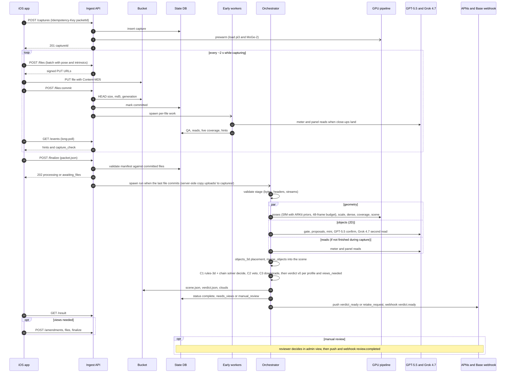

---
cursor:
  subagentId: "bc-3d53eca5-7f17-5982-87e1-4e474bf103c0"
---

# Hosted architecture: capture packet in, verdict out

2026-09-26, v0.1 (v0 revised 22:5x UTC against the builder briefs and the Modal GPU benchmark; change log in §5). For Hunter. Inputs: [capture packet spec v0.4](/cursor/stores/bc-5bc79926-909c-4cfb-aa62-24b3a44735e2/docs/capture-packet-spec.md), [gate decision](/cursor/stores/bc-5bc79926-909c-4cfb-aa62-24b3a44735e2/docs/gate-decision.md), [scene and verdict format](/cursor/stores/bc-5bc79926-909c-4cfb-aa62-24b3a44735e2/docs/scene-and-verdict-format.md), A9 (`internal/breadth/A9-no-tape-scale.md`), and the Modal pipeline (`internal/modal-pipeline/`).

**Decisions in one screen**
- **Compute runs on Modal now and moves to GCP later with the same containers.** Stage code is plain Python behind a storage interface. The Modal image becomes a Dockerfile (`modal.Image.from_dockerfile`) so the same image runs on Cloud Run GPU or GKE.
- **Storage is a GCS bucket from day one.** The app uploads straight to it with signed URLs, so bytes never pass through our API. Egress to Modal costs about 1¢ per house. Cloudflare R2 is the drop-in alternative if no GCP project is ready (same S3-style API, zero egress).
- **Upload format: the packet's own files, one signed PUT each, streamed during capture.** A small commit call acknowledges each file, and `packet.json` is posted as the finalize body. No zip and no tus. Section 2 has the full API.
- **Processing starts during capture.** Meter and panel VLM reads, image QA and live coverage hints run as files arrive. The GPU container is prewarmed when the capture is created. Target time from last photo to verdict: **p50 about 3 min, p95 about 8 min**. Measured on Modal L4 (`internal/modal-pipeline/benchmark.md`, geometry only, before VLM and criteria): method time 148 / 259 / 324 s at 40 / 60 / 70 facade photos with the incremental mapper at 96.4 / 186.3 / 236.9 s, electro LiDAR (45 frames) 77 s, largest client time 397 s. The p95 held on every run; the p50 holds only when the mapper sees about 40–48 frames, so the pose stage thins to `HSS_POSES_SFM_MAX_FRAMES=48` and registers the rest as fixed-ARKit or through the image registrator.
- **Results reach the app by long-poll events (always), APNs push (production) and an HMAC-signed webhook to Base.** Retakes are amendment uploads against the same capture.
- **Vision APIs were about 80% of running cost before the B3 cheap gate** (about $0.75–1.8 per house). With the measured cascade (`internal/breadth/B3-cheap-gate.md`: CLIP ∪ SigLIP top-2 frames per equipment class, GPT-5.4-mini then GPT-5.5, meters GPT-5.5 + Grok 4.7) VLM cost is ≈ $0.30 per house ($2.32 → $0.30, −87%), ≈ $0.40–0.55 with Grok 4.7 second reads on decision-bearing objects (WS-07). Geometry-only GPU is $0.05–0.15 per house on L4 (benchmark). The real scaling cost is human review of manual-review cases (A9: about a third of site decisions; E2E: 100% of ETH3D photo-model verdicts went to review).

## 1. Services

Volumes: 100 houses a day is about 3,000 a month; 1,000 a day is about 30,000. Packet size is about 50 MB for 60 non-LiDAR keyframes and 75–120 MB for a guided capture with 150+ frames or LiDAR; results add about 30 MB. Costs are rough monthly USD at list prices.

| # | Service | Recommended now (Modal phase) | Production (GCP) | Why | $/mo at 100/day | $/mo at 1,000/day | Demo? |
|---|---|---|---|---|---|---|---|
| 1 | **Ingest API** (captures, signed URLs, commit, finalize, events, result) | FastAPI as a Modal `@modal.asgi_app`, CPU, `min_containers=1` | Same FastAPI container on Cloud Run (min 1 instance) | A thin API with no bytes through it, so tiny instances suffice | ~$15 | ~$50 | **Yes** |
| 2 | **Object storage** (raw packets and result assets) | GCS regional bucket, V4 signed URLs, lifecycle to Nearline after 30 days (R2 as the alternative) | Same bucket, co-located with GPUs (egress then $0) | Direct-from-phone upload, per-object integrity (`Content-MD5`), lifecycle for personal data, portable S3/XML multipart | ~$50 (~$20 storage + ~$30 egress to Modal) | ~$500 (egress $0 once on GCP) | **Yes** |
| 3 | **Job queue and orchestration** | one `coordinate_run` CPU function per run doing Modal `.spawn()` per stage with orchestrator-managed attempts (L4, L4, A100-40GB), heartbeats every 30 s, stale at 180 s, a 5-min sweeper (`modal.Period`) that re-spawns dead coordinators and enforces the 20-min hard stop; eleven stages `validate, poses, objects, reads, scale, dense, coverage, scene, objects_3d, criteria, result` | Pub/Sub plus Cloud Run jobs or Cloud Workflows (or Kueue on GKE); stage table unchanged | Modal queues and scales; Modal-managed retries cannot change the GPU, so attempts are orchestrator-managed. Keeping stage state in our DB makes the executor swappable. | ~$5 | ~$20 | **Yes** (spawn only) |
| 4 | **GPU workers** | `Pipeline` class (WS-03), L4, `scaledown_window=900` plus prewarm at capture creation and `min_containers=1` in demo windows (the benchmark's `scaledown_window=900` alone kept no container warm: every call booted, 30–76 s overhead); CPU-only containers for coverage, scene, criteria and the early workers | Cloud Run GPU (L4) at 100/day; GKE L4 node pool with committed use or spot at 1,000/day | L4 fits π³ + MoGe-2 (24 GB). COLMAP CUDA is built for 80/86/89/90. | ~$300–600 (≈ $0.10–0.20/house) | ~$3,000–6,000 on Modal (30–50% less on GKE with commitments), **plus Modal Team plan (~$250) because Starter caps at 10 GPUs** | **Yes** |
| 5 | **Results store and database** | Demo: `modal.Dict` for capture state; scene, verdict and clouds as files in the bucket | Cloud SQL Postgres (HA at 1,000/day), JSONB for verdicts, PostGIS optional | Captures, files, stages, verdicts, reviews and events are relational; large assets stay in the bucket | ~$50 | ~$250 | Dict only |
| 6 | **Vision model APIs** | OpenAI GPT-5.5 + xAI Grok 4.7 agreement pair; GPT-5.4-mini as the only cheap tier, behind the CLIP ∪ SigLIP gate (B3) | Same; add Batch and prompt caching where latency allows | Hunter's model decision; no Anthropic | ≈ $900 (≈ $0.30 per house, B3; pre-gate estimate was $2,300–5,000) | ≈ $9,000 (pre-gate estimate $23,000–50,000) | **Yes** |
| 7 | **Meter-dimension table and footprint lookup** | Versioned `meter_models.json` in the image (Itron CENTRON etc., A9); footprint skipped | Postgres table editable from the reviewer view (Base calipers ~15 models, A9 §7); Overture/Microsoft footprints as GeoParquet in the bucket, DuckDB bbox query by packet GPS (optional Google Geocoding, $5/1k) | Table is the primary no-LiDAR scale source; footprint is a check only (p90 5.5%, A9) | ~$0–15 | ~$0–150 | Table yes, footprint no |
| 8 | **Auth for the iOS app** | Static bearer token per demo device (Modal secret) | Base's IdP issues a short-lived JWT (aud `capture-api`), API verifies by JWKS; Apple App Attest on capture creation; Identity Platform if Base has no IdP | Capture-scoped access; signed URLs carry storage auth, so the app never holds cloud credentials | $0 | ~$0 | Token only |
| 9 | **Notifications to the app** | Long-poll `GET /events` (verdict ready, live hints, retake request) | + APNs token auth (.p8) direct or via FCM; + HMAC webhook to Base's backend | Long-poll works on Modal without extra setup; push covers the backgrounded app; the webhook feeds Base's SSR/CRM | $0 | $0 | Long-poll yes, push optional |
| 10 | **Secrets** | Modal Secrets `hss-<env>-vlm` (`OPENAI_API_KEY`, `XAI_API_KEY`), `hss-<env>-api` (`CAPTURE_API_TOKENS`, `WEBHOOK_HMAC_SECRET`, `UPLOAD_URL_HMAC_SECRET`), `hss-<env>-gcp` (project, bucket, runtime SA, WIF audience); no GCS signer key: signed URLs use Modal OIDC → GCP Workload Identity Federation and IAM `signBlob` | GCP Secret Manager (`secret--house-scanning--<env>--<name>`) mounted as env vars | Code reads env vars only, so moving is config | $0 | <$5 | **Yes** |
| 11 | **Logging and monitoring** | Modal logs and dashboard; structured JSON logs keyed by `capture_id`/`run_id` | OpenTelemetry to Cloud Logging, Monitoring and Trace; Sentry for server and app errors; alerts on time-to-verdict p95, stage failures, VLM disagreement, cost per house | One trace per capture across API, workers and VLM calls | $0 | ~$100–300 (incl. Sentry) | Modal logs only |
| 12 | **Admin / reviewer view** | Read-only HTML page served by the API: photos, verdict criteria with coverage evidence, `views_needed`, three.js PLY viewer | Internal web app on Cloud Run behind IAP (Workspace SSO): review queue, per-criterion override, one-tap meter-read confirm, "send retake request", re-run | A9 routes about 33% of site decisions to review: ~33 / ~330 reviews a day, ~3 / ~28 reviewer-hours a day at 5 min each | $0 | ~$30 (+ reviewer labour) | Read-only page |

**Totals:** the pre-gate estimate was about $2.8k–6k a month at 100/day and $27k–57k at 1,000/day (about $1–2 per house, dominated by the VLM line). With the measured B3 cascade the per-house running cost is ≈ $0.30 VLM (≈ $0.40–0.55 with object second reads) plus $0.05–0.15 GPU, before storage, egress and review labour. Remaining levers, largest first: moving GPUs next to the bucket, keep-warm cost, and lowering the review rate (meter dimension table, TrueDepth scan, head-on `views_needed`).

**Compute detail (measured, Modal list prices).** An L4 container with 8 vCPU and 24 GiB costs about $1.37/hour (rate card $0.000222/s GPU + 8 × $0.0000131/s CPU + 24 × $0.00000222/s memory), and a CPU-only 8 vCPU container about $0.51/hour. Measured per run on L4 (`internal/modal-pipeline/benchmark.md`): extract 9.4–15.2 s, match 3.7–7.9 s, incremental mapper with σ 3 cm priors 96.4 / 186.3 / 236.9 s at 40 / 60 / 70 photos (27.8 s for the 45-frame electro LiDAR packet), π³ 10.0–18.3 s, depth 4.5–8.4 s, coverage 0.25–0.29 s; container `enter_s` 14.6–22.3 s; L4 memory 7,127 of 23,034 MiB; estimated $0.050–0.151 per run. A6's 15–25 CPU-minutes per house on 4 vCPU (no GPU) is the upper bound without a GPU. Peak concurrency at 1,000/day (12-hour day, 3× peak) is about 15–20 GPUs.

## 2. Upload design

### 2.1 Options compared

| | Single zip at the end | **Per-file signed PUT, streamed during capture, plus commit and finalize (recommended)** | Resumable (tus or chunked) |
|---|---|---|---|
| Time on the critical path after the last photo | whole packet: 75 MB takes 60 s at 10 Mbps and 120 s at 5 Mbps | only the backlog (~last few frames, streams ~1 MB, packet.json): **~3–10 s** if the uplink averages ≥ 2 Mbps (75 MB over a 5-min capture) | same as the zip unless it's also streamed |
| Processing before capture ends | none | **yes**: each committed file starts its work (VLM reads, QA, live hints) | only if split per file |
| Failure domain | one 75 MB transfer (restart or needs its own resume) | one ~0.75 MB file; packet-level resume comes from per-file commit | a byte range |
| Device cost | zipping plus a second copy of the packet; JPEGs don't compress (<2%) | none; files already exist per the spec layout | tus client library |
| Server cost | bytes through our API or one big signed URL | bytes go phone → bucket; API handles only small JSON | a tusd server in the byte path (scaling, storage backend) |
| Fit with spec §5 rule 5 ("individually and resumably", ack per file, packet.json last) | contradicts | **matches** | matches, heavier |

tus is only worth it if single files above ~50 MB become common (for example video). Those go through the multipart branch of the same API instead.

**Formats**
- **Keyframes: JPEG q0.9, unrotated, exactly as the spec says. No HEIC.** HEIC would save ~40% (~20–30 MB per house), but COLMAP's FreeImage, OpenAI and xAI image inputs don't take it. The server would have to transcode, which adds ingest time and breaks "never re-encode". The uplink needed for streaming (~2 Mbps average) is already modest.
- **HEIC is accepted only for `photo_only` stills imported from Photos.** The server transcodes them to JPEG at ingest (pillow-heif, EXIF kept) and records it in `provenance.notes`.
- **Depth and confidence: raw `.depth.f32` / `.confidence.u8` per spec §4** (245 KB per LiDAR keyframe, ~15 MB per house). Upload each alongside its keyframe. zstd is a later optimisation for the spec owner.
- **Streams: gzip at the end as `streams/<name>.csv.gz`,** listed under that path in `files[]` (~1 MB total).
- **`packet.json` is the finalize request body** (gzip allowed), stored as `captures/{id}/packet.json`. It stays authoritative: its `files[]` must match the committed set.
- **Mesh and TrueDepth bundles over 16 MiB use the multipart branch** (8 MiB parts).

**Upload order on the device** (a priority queue, 4 concurrent PUTs):
1. `meter_close`, `meter_oblique`, `panel_*` stills. They feed the slowest step (Grok 4.7 is 41–78 s per image), which then runs while the user keeps walking.
2. Keyframes in capture order, each with its depth.
3. Other stills.
4. Streams and mesh.
5. Finalize.

**iOS transport.** A foreground `URLSession` streams during capture for the lowest latency, and any backlog is handed to a background session (`isDiscretionary = false`, upload from file) when the app backgrounds. Local files are kept until finalize returns `processing` and every file is committed (spec §5 rule 5).

### 2.2 API

Base URL `https://capture-api.<domain>/v1`, JSON, UTF-8. Every request carries `Authorization: Bearer <token>`: a JWT from Base's IdP in production, a static token in the demo. Storage PUTs carry no bearer; the signed URL is the authorisation.

| Method and path | Purpose | Idempotency |
|---|---|---|
| `POST /captures` | create the capture; prewarm the GPU | `Idempotency-Key: <packetId>` (required) |
| `POST /captures/{id}/files` | register a batch of ≤ 50 files with metadata; get signed upload URLs | by `(captureId, path)` |
| `POST /captures/{id}/files:commit` | acknowledge uploaded files; triggers per-file work | by path; repeat commits are no-ops |
| `POST /captures/{id}/files:complete` | complete a multipart upload (part ETags) | by path |
| `POST /captures/{id}/finalize` | body = `packet.json` | same packet SHA-256 → same run; a different one → 409 |
| `GET /captures/{id}/events?after=<seq>&wait=25` | long-poll: live hints, stages, verdict ready, retake request | read-only |
| `GET /captures/{id}` | status (ETag / `If-None-Match`) | read-only |
| `GET /captures/{id}/result` | verdict summary, `views_needed`, signed links | read-only |
| `POST /captures/{id}/amendments` then `.../amendments/{aid}/finalize` | retake answering `viewsNeeded` or `memberActions` | `Idempotency-Key: <amendmentId>` |
| `POST /captures/{id}/confirmations`, `GET /captures/{id}/confirmations` | one-tap answer to a meter-number (or panel brand / main amps) pre-fill: `{fieldId, kind: confirmed\|corrected\|none, value?, imageId, clientAt}` → `201 {confirmationId, fieldId, imageId, kind, receivedAt, seq}` | by `(captureId, fieldId)`; a different answer → `409 confirmation_conflict`; `409 capture_closed` once the capture is `complete`, `failed` or `expired` |
| `GET /captures/{id}/review` | the read-only reviewer page (bearer-protected) | read-only |
| `POST /devices` | register an APNs token | by token |
| `DELETE /captures/{id}` | cancel and delete (privacy); later calls answer `410 capture_deleted` | idempotent |
| `GET /healthz` | `{status, storage, state, wifTokenExpiresAt, version}`; `503` when degraded or within 5 min of the Modal identity token's expiry; no bearer | read-only |

**Create**

```http
POST /v1/captures
Idempotency-Key: 6f3c1d7e-2b0a-4a4e-9a51-0f1e2d3c4b5a
{"packetId": "6f3c1d7e-2b0a-4a4e-9a51-0f1e2d3c4b5a", "formatVersion": "0.4", "tier": "arkit",
 "flow": "guided", "device": {"model": "iPhone16,1", "systemVersion": "18.2", "appVersion": "1.4.0"},
 "orderRef": "base-order-8812", "expected": {"keyframes": 150, "stills": 10}}
```
```json
201 {"captureId": "cap_01J9Z6K4", "status": "uploading",
     "upload": {"maxSinglePutBytes": 16777216, "partBytes": 8388608, "urlTtlS": 3600, "maxFiles": 2000, "maxBatch": 50},
     "eventsUrl": "/v1/captures/cap_01J9Z6K4/events", "finalizeBy": "2026-09-27T20:41:00Z"}
```
A replay with the same key returns `200` and the same body. The same key with a different body returns `409 idempotency_conflict`. `flow` (`guided|photo`) exists only in the API: the packet has no `flow` field, and when the app omits it the server infers `guided` for ARKit tiers and `photo` for `photo_only`. `formatVersion` other than `"0.4"` → `422 format_version_unsupported`.

**Register a batch.** `meta` carries the keyframe or still record the file belongs to (the same objects `packet.json` will hold). This lets the server work on a frame before finalize.

```json
POST /v1/captures/cap_01J9Z6K4/files
{"files": [
  {"path": "stills/s01.jpg", "bytes": 3120448, "sha256": "fbff…d7", "md5": "q1Zk…==", "role": "still",
   "contentType": "image/jpeg", "meta": {"still": {"id": "s01", "purpose": "meter_close", "img": "stills/s01.jpg", "keyframe": "k00131", "w": 4032, "h": 3024, "timestamp": 84250.88, "orientation": 1}}},
  {"path": "keyframes/k00012.jpg", "bytes": 742113, "sha256": "…", "md5": "…", "role": "keyframe", "contentType": "image/jpeg",
   "meta": {"keyframe": {"id": "k00012", "w": 1920, "h": 1440, "intrinsics": [1442.1, 1442.1, 959.6, 719.4],
            "pose": [16 numbers], "timestamp": 84233.12, "tracking": "normal", "epoch": "e1", "reason": "motion"}}},
  {"path": "geometry/mesh.ply", "bytes": 41943040, "sha256": "…", "role": "mesh", "contentType": "application/octet-stream"}]}
```
```json
200 {"files": [
  {"path": "stills/s01.jpg", "state": "pending", "upload": {"method": "PUT",
     "url": "https://storage.googleapis.com/hss-captures-prod/uploads/cap_01J9Z6K4/stills/s01.jpg?X-Goog-Signature=…",
     "headers": {"Content-Type": "image/jpeg", "Content-MD5": "q1Zk…=="}, "expiresAt": "2026-09-26T21:41:00Z"}},
  {"path": "keyframes/k00012.jpg", "state": "committed"},
  {"path": "geometry/mesh.ply", "state": "pending", "upload": {"method": "MULTIPART", "uploadId": "…",
     "parts": [{"n": 1, "url": "…"}, {"n": 2, "url": "…"}, …], "completeUrl": "/v1/captures/cap_01J9Z6K4/files:complete"}}]}
```
- `role` takes exactly the packet's `files[].role` values (`keyframe`, `depth`, `confidence`, `features`, `still`, `stream`, `truedepth`, `mesh`, `compat`, `other`); `keyframe_image` and any other spelling → `422 role_unknown`. `meta` is the keyframe, still or `trueDepthFrame` record exactly as `packet.json` will hold it.
- Object keys are deterministic and use two prefixes: signed PUTs write `uploads/{captureId}/{path}`; when the packet is accepted and every listed file is committed, the server copies each file (generation-pinned) to `captures/{captureId}/{path}`, which is what every pipeline stage reads. The 7-day lifecycle rule applies to `uploads/` only, so finalized packets, `packet.json`, run artifacts and early-worker blobs under `captures/` are never swept.
- The signature binds method, content type and `Content-MD5`, so storage rejects corrupted bytes with `400 BadDigest` (single PUTs; multipart parts carry no MD5 and are checked by size at commit and by SHA-256 in the pipeline's `validate` stage).
- Re-registering refreshes expired URLs. Re-registering a committed path with a different `sha256` returns `409`.

**Commit** (batch it, e.g. every 2 s or 10 files)

```json
POST /v1/captures/cap_01J9Z6K4/files:commit
{"files": [{"path": "stills/s01.jpg", "sha256": "fbff…d7"}]}
200 {"committed": ["stills/s01.jpg"], "notFound": [], "mismatch": []}
```
- The server HEADs each object (size, `md5Hash`, generation), then marks it committed with that generation, which pins the bytes the pipeline reads.
- `mismatch` means re-upload. SHA-256 is re-checked when the pipeline reads the file.

**Finalize.** It may be sent before the backlog drains. Processing starts the moment the last listed file commits.

```http
POST /v1/captures/cap_01J9Z6K4/finalize
Idempotency-Key: 6f3c1d7e-…            X-Packet-Sha256: 9a1b…        Content-Encoding: gzip
<packet.json>
```
```json
202 {"status": "awaiting_files", "missing": ["keyframes/k00148.jpg", "streams/imu_raw.csv.gz"], "runId": "run_7Q2", "etaS": 200}
202 {"status": "processing", "missing": [], "runId": "run_7Q2", "etaS": 180}
422 {"errors": [{"code": "tap_replay", "pointer": "/taps/0", "message": "ray origin off by 0.12 m"}]}
```
Finalize runs the manifest stage of spec §6 synchronously (schema, tier rules, `files[]` vs committed, tap replay at 1e-3, depth / confidence / features byte sizes from `files[].bytes`, the v0.4 scale-input rules) and answers `422` with RFC 6901 pointers. Checks that need the bytes (SHA-256, image headers, stream contents) run in the pipeline's `validate` stage after the last commit; their failures surface as a `failed` event (`next: manual_review` when images are usable, else `none`), never as a late 422.

**Events** (the one mechanism for live hints and results)

```json
GET /v1/captures/cap_01J9Z6K4/events?after=41&wait=25
200 {"status": "uploading", "next": 43, "events": [
  {"seq": 42, "type": "hint", "at": "…", "data": {"code": "meter_plate_unreadable", "message": "Step a little closer so the meter label is sharp", "retake": "meter_close", "promptId": "hint.meter_plate_unreadable"}},
  {"seq": 43, "type": "capture_check", "data": {"complete": false, "missing": ["meter_oblique", "ground_downward_right"], "meterRead": "pending"}}]}
```
- Event types (10): `files_committed`, `hint`, `capture_check`, `stage`, `verdict_ready`, `retake_request`, `review_started`, `review_completed`, `failed`, `confirmation`. `data` is camelCase and typed per WS-00's `api.py`; `next` is the last returned `seq`.
- `capture_check` is the quick "you can leave" answer. It comes from ARKit-pose coverage and the already-finished meter read, before any 3D model exists. `missing[]` uses the shared 16-code list (`meter_close`, `meter_oblique`, `meter_closeups_in_session`, `meter_tap`, `door_view_meter_side`, `panel_close`, `panel_open`, `main_disconnect`, `keyframe_count`, `keyframe_cadence`, `tracking_quality`, `photo_count`, `wall_left_of_meter`, `wall_right_of_meter`, `ground_downward_left`, `ground_downward_right`); wall ids do not exist before the scene, so coverage codes say `left` / `right` of the meter. `door_view_meter_side` and `meter_tap` are `unknown` (not `missing`) until finalize, because `scaleReference.ext.doorViews` and `taps[]` travel only in `packet.json`.

**Result**

```json
GET /v1/captures/cap_01J9Z6K4/result
200 {"runId": "run_7Q2", "status": "needs_views",
     "site": {"decision": "manual_review", "reasons": ["ground_surface unobserved at w1 s 3.0–5.5 m"]},
     "scale": {"source": "meter_model", "status": "verified", "relBound95": 0.014},
     "criteria": [{"id": "route_length", "outcome": "pass", "measuredFt": 10.4, "plusMinusFt": 0.4, "thresholdFt": 16, "coverage": "observed"},
                  {"id": "ground_surface", "outcome": "unsure", "unsureCause": "unobserved", "coverage": "unobserved"}],
     "viewsNeeded": [{"id": "vn3", "kind": "band", "band": "ground", "wallId": "w1", "sM": [3.0, 5.5], "outM": 3.7, "viewingAngleDeg": [20, 60],
                      "target": "downward photo of the ground in front of this wall, from chest height",
                      "criteria": ["ground_surface"], "why": "ground strip unobserved",
                      "promptId": "vn.ground.unobserved", "prompt": {"title": "Show us the ground", "body": "From chest height, point the phone down at the ground to the right of your meter, 14 ft along, so we see about 12 ft out from the wall."},
                      "targetRegionArkit": {"surface": "ground", "polygon": [[…], […], […], […]]}, "suggestedCameraPoseArkit": [16], "referenceCrop": null}],
     "memberActions": [], "meter": {"status": "prefill_confirm", "value": "…", "candidates": ["…"], "barcodeConfirmed": false, "readersAgree": true, "clean": false, "evidence": {"image": "s01", "boxPx": null}},
     "outcome": {"kind": "needs_more_photos", "profile": "C", "message": "One more photo helps us finish your check.", "arkitEpoch": "e1", "frameToArkit": [16],
                 "recommendedPlacement": null, "cableRoutePolylineArkit": null, "viewsNeeded": ["same objects as above"], "reasons": []},
     "verdictUrl": "<signed, 15 min>", "previewUrl": "<signed decimated .ply>", "reviewUrl": "/v1/captures/cap_01J9Z6K4/review"}
```
- `status` is one of `uploading`, `awaiting_files`, `processing`, `needs_views`, `complete`, `manual_review`, `failed`, `expired`; `outcome` is `null` while `status ∈ uploading, awaiting_files, processing`.
- The body is WS-00's `ResultResponse` (`server/contracts/result.py`, camelCase on the wire, the full field list in `docs/server-pipeline-build-plan.md` §5): the verdict summary, the customer-safe copy (`promptId` + `prompt {title, body}` from WS-14's catalogue), the AR anchors (`frameToArkit` = the inverse of the scene's `frame.from_source`, valid only when the scene's source frame is an ARKit epoch; `targetRegionArkit`, `suggestedCameraPoseArkit`, `recommendedPlacement.boxArkitWorld`, `cableRoutePolylineArkit`), and, for the photo flow without ARKit poses, `referenceCrop` instead of anchors. Every `viewsNeeded` entry names the wall (`wallId`, `sM`) and the viewing-angle band the new photo must satisfy (`viewingAngleDeg`), because coverage grading, not geometry error, is the main cause of undecided outcomes (E2E §4). The full verdict v0 is linked (`verdictUrl`), not embedded, by default.
- `meter.status` is `auto_filled` only on a zxing barcode match or a confirmation; GPT-5.5 + Grok 4.7 agreement alone (65/68 correct, Wilson low 87.8%, B3 §3.1) is a one-tap pre-fill answered through `POST /captures/{id}/confirmations`.
- Whether the homeowner ever sees `reject` is Base's product call (`SHOW_REJECT_TO_HOMEOWNER`, default false): the device then sees `manual_review` with empty `reasons`, and the true decision reaches the reviewer page and the webhook only.

**Retake (amendment).** The app calls `POST /captures/{id}/amendments {"amendmentId": "<uuid>", "answers": ["vn3"]}` and gets back `{"amendmentId", "pathPrefix": "amendments/a1/"}`. It then uses the same `files`, `commit` and finalize endpoints. The amendment is an ordinary v0.4 packet with its own epochs and a fresh `packetId`, since relocalisation into the first session may fail; it carries the parent's `packetId` in `parentPacketId` (spec v0.4) and the parent's `formatVersion`, and the path carries the link too. The server re-runs on the union of both packets, using the first packet's model and scale and registering the new frames into it. Amendments are accepted only while the capture is `needs_views` or `manual_review`, one open at a time; `answers[]` must name ids from `viewsNeeded` or `memberActions`.

**Push and webhook**
- APNs payload: `{"aps": {"alert": {"title": "Your site check is ready"}}, "captureId": "cap_01J9Z6K4", "type": "verdict_ready" | "retake_request"}`. There is no decision or address in the push; the app fetches `/result`.
- Base webhook: `POST <BASE_WEBHOOK_URL>` with header `X-Capture-Signature: t=<unix>,v1=<hex HMAC-SHA256(secret, t + "." + body)>` and body `{"id": "evt_…", "type": "verdict.ready" | "review.completed", "captureId", "orderRef", "runId", "decision", "verdictUrl"}`. Retries use exponential backoff for 24 h, and the receiver dedupes on `id`.

**Retries (client)**

| Response | Action |
|---|---|
| Network error, timeout, 408, 429, 5xx | exponential backoff with full jitter, 1 s → 60 s cap, unlimited while the capture is open; honour `Retry-After` |
| Storage 403 with an expired signature | re-register the path (fresh URL), then retry |
| Storage 400 `BadDigest` | re-read the file and retry once; then report `mismatch` in a commit so it lands in logs |
| API 409 on create or finalize | a conflicting replay; the app has a bug, so surface it and don't retry |
| API 422 on finalize | fix is app-side; the server keeps the files and, if images are usable, routes to manual review |
| Relaunch after the app was killed | `GET /captures/{id}`, then re-register uncommitted files (returns `committed` or fresh URLs) and continue |

**Limits.** At most 2,000 files, 16 MiB per single PUT (larger goes multipart), URLs valid 60 min, finalize within 24 h, 1 GiB per capture, 256 MiB per file, 20 open captures per principal. Unfinalized captures expire, and a lifecycle rule deletes their `uploads/` objects after 7 days; promoted `captures/` objects move to Nearline after 30 days and are never lifecycle-deleted (the retention period for finalized packets is Base's call).

## 3. Capture to verdict



**Latency budget.** Times are measured from the last photo. Budgets are the targets; the "measured" column is the Modal L4 benchmark of 2026-09-26 22:28 UTC (`internal/modal-pipeline/benchmark.md`, housepipe scaffold, eth3d-facade at 40 / 60 / 70 photos and eth3d-electro LiDAR at 45 frames) or the breadth report named. "Hidden" means the step runs during capture or in parallel.

| Step | p50 budget | p95 budget | Measured | How |
|---|---|---|---|---|
| Upload backlog + streams + finalize | 5 s | 60 s | not yet (replay client, WS-11) | streamed during capture; p95 is a weak uplink |
| Finalize validation (manifest stage) | 2 s | 5 s | packetgen validator 0.03–0.05 s per 47-keyframe packet (WS-02 measurements) | schema, tier rules, `files[]` vs committed, tap replay, byte sizes; hashes move to the `validate` stage |
| Queue + container | 2 s | 60 s | cold-call overhead 73 s (`client_s` 91.7 vs `method_s` 18.8); container `enter_s` 14.6–22.3 s once the image is pinned; `scaledown_window=900` kept nothing warm | prewarm at capture creation is load-bearing; `min_containers=1` in demo windows |
| Meter / panel reads (VLM pair), image QA + gate scores | hidden | hidden | Grok 4.7 median 41 s / p90 78 s per image (B2, B3); GPT-5.5 median 7.2 s / p90 9.1 s | early workers at file commit; per-call timeout 120 s, 3 tries |
| SIFT extract + matching | 10 s | 20 s | extract 9.4–15.2 s, match 3.7–7.9 s | CUDA SIFT at ≤ 2048 px, spatial 40 / 20 m + sequential 10 pairs |
| Incremental mapper with σ 3 cm ARKit priors | 60 s | 240 s | 96.4 / 186.3 / 236.9 s at 40 / 60 / 70 frames (27.8 s for the 45-frame LiDAR packet) | the whole p50 miss above ~40 frames; `poses` thins to 48 SfM frames and registers the rest fixed-ARKit or via the image registrator; stage timeout 420 s |
| Scale (LiDAR align or A9 meter model) | 1 s | 5 s | LiDAR alignment 0.017 s (electro) | reads already done |
| Dense (LiDAR TSDF ≤ 5 m, π³ 8-view windows) | 40 s | 90 s | π³ 10.0 / 15.4 / 18.3 s; LiDAR fuse 0.034 s; depth 4.5–8.4 s | L4; stage timeout 300 s |
| Coverage grid + occlusion, scene | 30 s | 60 s | coverage 0.25–0.29 s on the scaffold grid (the §3.1 grid with bands and depth-aware occlusion is unmeasured) | CPU; stage timeouts 120 s each |
| Object confirmation (2D cascade, parallel with SfM) then `objects_3d` | hidden | 90 s | B3 cascade wall time 45–80 s per house with 16 parallel calls, bounded by Grok's tail | ≈ 30–38 API calls per house |
| C1 + C2 + C3 | 20 s | 60 s | C1 four profiles 6–24 s, C2 ≤ 40 s, coverage query build ~16 s on facade (WS-09, CPU) | C3 GPT-5.5 calls in parallel; stage timeout 180 s |
| Write, notify, APNs delivery | 3 s | 10 s | compose < 3 s (WS-10) | |
| **Total to verdict** | **~3 min** | **~8 min** | geometry-only method 148 / 259 / 324 s and client 178 / 335 / 397 s at 40 / 60 / 70 frames; electro LiDAR method 77 s, client 132 s; A10G facade-70 method 230 s | hard stop at 20 min → manual review; the p50 holds at ~40–48 SfM frames, the p95 held on every run |
| `capture_check` ("you can leave") | **≤ 30 s** | 90 s | not yet (WS-03 gate) | ARKit-pose coverage + meter read; no 3D model needed |

**Failure handling**

| Failure | Handling |
|---|---|
| App killed or offline mid-upload | Background session continues; on relaunch the app re-registers pending files. The capture stays `uploading` for 24 h. Files stay on the device until they are committed. |
| Files missing at finalize | `awaiting_files` with the list; the run auto-starts on the last commit. After 24 h: `expired`, plus a push asking to reopen the app. |
| Packet invalid at finalize (schema, tier rule, tap replay, byte sizes, scale inputs) | `422` with JSON pointers, synchronously; the packet is not stored and a corrected packet may follow. |
| Packet invalid in the `validate` stage (SHA-256, image headers, stream contents, once every file is committed) | `failed` event with `code: packet_invalid`; if ≥ 60% of the listed images decode (at least 10), the capture goes to manual review (`next: manual_review`), else `failed`; the iOS team is alerted either way. |
| GPU crash or OOM | orchestrator-managed attempts (`retries=0` on the stage functions): attempts 1–2 on L4, the third on `A100-40GB`; then manual review with `stage_exhausted:<stage>:<code>`. |
| SfM fragments (photo flow) | Not an error. Keep the largest model containing the meter; mark the rest unobserved, which produces `views_needed` (gate decision §1). |
| One VLM provider down or slow | 3 tries, 120 s timeout per Grok 4.7 call (measured median 41 s, p90 78 s; GPT-5.5 60 s, GPT-5.4-mini 30 s), 300 s per image. A single-model read is "unconfirmed": one-tap confirm in the app or review, never auto-fill. If both are down for 10 min, go to manual review; `objects` and `reads` are optional stages, so the run continues degraded and never ends `eligible`. |
| Scale `unverified` or in conflict | `memberActions: ["retake_meter_closeups"]` or `["truedepth_meter_scan"]` as a retake request (A9). Never a tape. |
| Stage hung | Heartbeat every 30 s in the stage table; the coordinator cancels and re-spawns a stage whose heartbeat is older than 180 s (the 5-min sweeper re-spawns a dead coordinator, at most twice). At most 2 re-spawns per stage, then manual review. |
| Duplicate calls, retries | Idempotency keys on create, finalize and amendments; commits by path; runs keyed by packet SHA-256. |
| Push not delivered | The app long-polls `/events` whenever it is foregrounded; the webhook retries for 24 h. |

## 4. Hackathon demo vs production

| | Hackathon demo (minimal) | Production |
|---|---|---|
| Deploy | One Modal app `house-scanning` per environment (`dev`, `prod`), composed in `server/modal_app.py` from the API app (`hss-capture-api`, asgi, CPU, `min_containers=1`, web label `house-scanning-capture-api`), the early workers, the coordinator and `Pipeline` (L4, `warm()`), deployed from CI by pinned SHA | API and reviewer app on Cloud Run; the pipeline as a Cloud Run GPU job (L4) or GKE L4; same images from one Dockerfile |
| Storage | GCS bucket with signed URLs (R2 if no GCP project). Fallback if neither is ready: the API issues `url`s pointing at itself (`PUT /v1/uploads/{token}` into the Modal volume). The client contract is unchanged. | GCS regional, CMEK optional, lifecycle, retention set by Base (packets are personal data) |
| State | `modal.Dict` for captures, files and events | Cloud SQL Postgres: `captures`, `files`, `stages`, `verdicts`, `views_needed`, `reviews`, `events`, `devices` |
| Early processing | meter / panel VLM reads + ARKit-pose coverage hints + blur/exposure QA only | + incremental SIFT and matching, per-frame MoGe-2 / OWLv2, if the bench shows they're on the critical path |
| Auth | static bearer per device | Base IdP JWT + App Attest; reviewer app behind IAP |
| Notifications | long-poll `/events` | + APNs + Base webhook |
| Review | read-only HTML page per capture (photos, criteria with coverage, views needed, PLY viewer) | queue, overrides, meter-read confirm, retake request, re-run, audit log |
| Scale inputs | `meter_models.json` in the image | Postgres table with Base's caliper measurements; footprint check via Overture GeoParquet + DuckDB |
| Observability | Modal logs | OTel → Cloud Logging / Monitoring / Trace, Sentry, SLO alerts, cost per house |
| Cost | under $50 for the demo days (Starter's $30 of credit covers most GPU) | section 1 |

**Build order for the demo.** Superseded by the `server/` package and the builder briefs (`docs/build/README.md`): WS-01 owns the API and storage backends, WS-03 the orchestrator, `Pipeline.warm()` and the early workers, WS-08 the meter and panel reads, WS-10 the result writer and the review page, WS-11 the replay client that uploads a stored packet file by file on a timer so the iOS app never blocks us. The earlier five-step list that put `api.py` into `internal/modal-pipeline/` is history.

**Decided since v0 (Hunter, 2026-09-26)**
- GCP layout: project `house-scanning` under the SMP billing account for product resources (bucket `hss-captures-<env>`, runtime SA `hss-runtime-<env>`, Modal WIF pool `modal-<env>`, CI SA `hss-gha`, budget); Terraform state in `gs://smp-substrate-tfstate-prod` under `house-scanning/<env>`; GitHub Actions identity through SMP's `github-actions` WIF pool; Artifact Registry, logging, monitoring and Secret Manager in `smp-shared-prod` at migration. Six SMP exceptions are recorded in WS-12's `docs/components/deploy.md` (Cloud SQL Postgres, `dev` + `prod` in one project, Sentry deferred, GPU runtime, Modal, manual `prod` approval).
- Storage is keyless: Modal OIDC → GCP Workload Identity Federation → IAM `signBlob`; no service-account key anywhere.

**Open for Hunter or Base**
- Whether customer photos may go to OpenAI and xAI (gate decision §10 Base 8; default `VISION_EXTERNAL_CALLS=on` in `dev`, explicit in `prod`), and which data-retention terms apply.
- Retention period for finalized packets (default: Nearline at 30 days, never deleted by lifecycle).
- Whether the homeowner sees `reject` (default no).
- Whether an unconfirmed meter number (pre-fill not yet tapped) may leave a site `eligible` (default no: it forces `manual_review`).
- Base's IdP (issuer, JWKS, audience) for the production JWT; static bearer tokens per device until then.
- A Modal Team plan before 1,000/day, because Starter caps at 10 concurrent GPUs; the $200 workspace spend limit and the `dev` $140 / `prod` $60 environment budgets are set in the Modal dashboard.

## 5. Change log

- v0.1 (2026-09-26, 22:5x UTC, coordinator; per `internal/build/reconciliation-queue.md` and `internal/build/seam-decisions.md` §9 item 1): `files[].role` example `keyframe_image` → `keyframe` and the role list stated; `meta.still` example carries `img`, `timestamp`, `orientation`; two-prefix storage layout (`uploads/` → `captures/`) and the 7-day rule scoped to `uploads/`; bucket `hss-captures-<env>`; `POST /captures/{id}/confirmations`, `GET /captures/{id}/review` and `GET /healthz` added; `flow` inference and `format_version_unsupported` stated; finalize validation split into the synchronous manifest stage and the `validate` stage; events list gains `confirmation`, `capture_check` example uses the shared code list with `left`/`right` and notes that door views and taps are `unknown` before finalize; result example rewritten to WS-00's camelCase `ResultResponse` with `outcome`, `viewingAngleDeg`, `promptId`/`prompt`, `meter` block and the hidden-reject rule; the stale `parentPacketId` sentence replaced; latency table rebuilt with the measured Modal numbers (mapper 96.4 / 186.3 / 236.9 s, cold-call overhead 73 s, `enter_s` 14.6–22.3 s) and the 48-frame SfM budget; Grok timeout 90 s → 120 s; VLM cost line and totals updated to the B3 cascade (≈ $0.30 per house) and the measured GPU cost ($0.05–0.15); secrets row made keyless with the `hss-<env>-*` names; failure table rows for the two validation stages, orchestrator-managed attempts and heartbeat numbers; §4 deploy row, build order and open decisions updated to the `server/` layout and the GCP layout decision. Unchanged: the upload design (§2.1), the endpoint contracts of §2.2 other than the additions above, the sequence diagram's shape.
