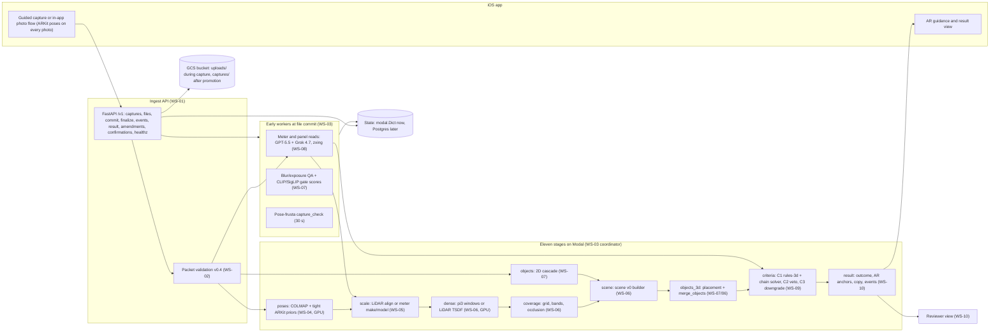
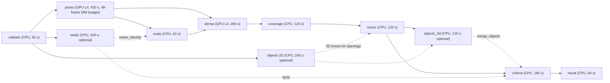
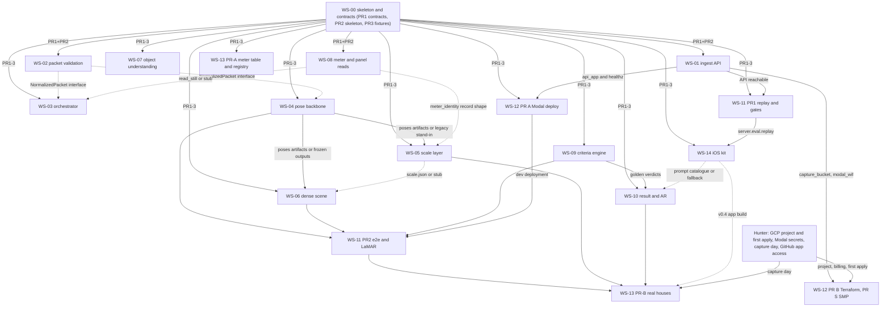

# Server Pipeline Build Plan (photos + ARKit in, eligibility verdict + AR guidance out)

Store root for every path below: `$S` = `/cursor/stores/bc-5bc79926-909c-4cfb-aa62-24b3a44735e2` (Context). Repo: `huntertcarver/house-scanning-server`, Python 3.12, `uv` + `ruff` + `pytest`, package `server/` (§3.3); the breadth experiments live under `recon/<path>` as read-only archives. Revision 2026-09-26 22:5x UTC: rewritten against the 15 builder briefs in `docs/build/`, `internal/build/seam-decisions.md` (SD-nn), `internal/build/reconciliation-queue.md`, the E2E report, B3 and the Modal GPU benchmark. Every number below is a measured value with its source; nothing is rounded beyond the source.

## 0. How to use this plan

- One builder per workstream (WS), one validator per workstream, never the same agent. Each WS has a brief in `docs/build/ws-XX-*.md` with the 13 sections of `internal/build/brief-template.md`; `docs/build/README.md` carries the index, the dependency graph, the wave order, the shared conventions and the kickoff templates. Precedence when texts disagree: `internal/build/seam-decisions.md` > the group decision log (`internal/build/decision-log-group-{a,b,c}.md`) > the brief > this plan; measured reports beat all prose.
- Builders never invent contracts: they implement against `docs/capture-packet-spec.md` (v0.4), `docs/scene-and-verdict-format.md` (scene v0, verdict v0), `docs/criteria-spec.md` (v0.2), `docs/hosted-architecture.md` §2.2 (API) and WS-00's `server/contracts`. Contract changes go through a spec PR that edits the store doc first, then `server/contracts` (WS-14 §4.3).
- Every WS ships unit tests, `python -m server.eval.cli validate` on its artifacts, a golden-site check (`eth3d-facade`, `eth3d-electro` packets; `eth3d-delivery` GT scene), a component page `docs/components/<ws>.md`, and pastes the gate table (WS-11 `gates.yaml`) into its PR.
- Safety invariant (non-negotiable): a pass or fail needs `observed` coverage evidence (format doc §3.1); `inferred` geometry can fail or stay unsure, never pass; `generated` geometry is unknown. The 0-unsafe-passes gate is necessary but not sufficient until a labelled passing site exists (§1, §8): decidability (share of criterion cells decided) is tracked next to it, and WS-13's R1 house is the first labelled pass.
- Model policy (Hunter, 2026-09-26, `docs/project-context.md`): Fable 5.1 Max (`claude-fable-5-1-thinking-max`) writes anything a builder reads as its spec (this plan, the briefs, contracts, architecture reviews); Opus 5.5 Medium (`claude-opus-5-5-medium`) runs research and experiment agents; Grok 4.7 builds, monitors PRs and executes infra. WS-00 may go to a stronger model (its brief is model-agnostic) because it fixes every shared name.

## 1. What the research established (evidence, real vs simulated)

| Finding | Number | Evidence type, source |
|---|---|---|
| Photo-only VLM judging (Base's SSR prompts) is unsafe as decider | unsupported placement passes on 3–4 of 6 real houses; 11 / 11 / 21 unsafe slots (Sonnet / Opus / GPT-5.5, only GPT-5.5 allowed) | real phone frames; C3, gate decision §3 |
| COLMAP with tight ARKit priors (σ 3 cm, no robust loss) is the pose backbone | openings 0.9–1.9 in median / 2.8–4.2 in p90 per segment on real ARKit frames; 15–26 ft 3.8 / 11.3 in at ARKit scale, 3.0 / 7.4 in with correct scale (scorer floor 1.7 / 5.4) | real Apple-device frames + laser; A6 (LaMAR) |
| ETH3D-tuned priors (σ 0.3 m, robust) fail on real walks | p90 up to 76 in on one segment; σ 0.10 m bent too (p90 101 in) | real; A6 |
| Image-only SfM on phone imagery fragments | folded on 2 of 5 real segments (−45.7 %, −18.8 % long-pair scale); every YouTube walkaround split into 3–6 models; `yt-LCPBf86oloE` 44/183 registered in 6 fragments with the meter close-ups unregistered | real; A6, A1/A3, E2E §5 |
| π³ / DA3-Large: good dense layer, weaker than COLMAP on phone frames | DSLR 0.9 / 2.0 in; phone p90 9–15 in at oracle scale; DA3 images-only failed 1 of 10 windows (+45 % scale) | DSLR + real phone; A2, A6 |
| Depth fusion as standalone model: no-go; predicted-depth occlusion test: go | 0.0 ft false-observed at 0.10 m relief; fused depth over ARKit poses 7.4 / 27.2 and 9.3 / 31.9 in | DSLR; A3 |
| Non-LiDAR ARKit scale alone is insufficient | real session scale 1.2 % median / 2.8 % p90; 5.7–17.8 % p90 in the simulated profiles; the C1 sweep keeps 12/12 GT passes at 0 in shape noise, 11/12 at 2 in, 8/12 at 4 in, 6/12 at 6 in, 0/12 at ≥ 12 in or under any ARKit drift profile | real + simulated; A6, C1 `outputs/sweep/summary.md` |
| Criteria need geometry within about 2–6 in and scale within about 1–2 % | rows above; A9 sweep: opening clearance kept 92 %, under-window 80 % at a 2 % bound | laser geometry sweep; C1, A9 |
| Zero-effort scale: meter make/model from two close-ups | 0.6 / 2.0 / 3.1 % (median / p90 / p95); 95 % of houses within 6 in at 15 ft, 89 % at 26 ft; 67 % of site decisions decidable; GPT-5.5 named the model family on 21/21 checkable real plates | **simulated** meter terms (registration, rim depth, contour confusion, table coverage all assumed), real plate reads; A9 |
| Tape measure would give 0.9 % p90 but is excluded (no customer tools) | 0.4 / 0.9 / 1.1 %; 81 % decidable | simulated; A8 |
| Known-size objects / footprints / passive sensors as sole scale: no-go | barn: doors + siding agreed on −9.7 % with a 1.3 % bound; footprints 5.5 % p90; passive priors 5.3 % p90 | real barn + modelled; A8, A9 |
| World Labs Marble 1.1: drop | scale −31 % / +12 %; erased the meter, invented a window | DSLR + real house; A5 |
| Meter number reads | GPT-5.5 69/73 top-1 (95 %), Grok 4.7 66/73 (90 %); pair agrees on 68/73 (93 %), 65/68 correct (95.6 %, Wilson low 87.8 %); top-3 71/73; zxing barcode confirms 10–11/73, all correct; server OCR 59–68 % top-1 (drop) | real close-ups; B2, B3 §3.1 |
| Panel hazards | 5/5 recalled brands flagged by every model; Grok 4.7 0 false alarms, GPT-5.5 3 + 1; B3 cascade (GPT-5.4-mini @2048 then GPT-5.5 on hazard / unprinted brand / amps claims) 5/5 with 0 false alarms at $0.0137 / $0.0067 per photo | real, 127 panel photos; B2, B3 §3.3 |
| Object detection | OWLv2 P/R 0.31/0.69; GPT-5.5 0.48/0.61, Grok 4.7 0.50/0.54; presence recall ≥ 0.83 every class for GPT-5.5 (Grok 0.73 downspout, 0.75 pool); 3D lift 4/6 facade openings, 0 false, 0.35 m with LiDAR-class depth; 0/6 under non-LiDAR drift | real images; B1 |
| Cheap gate before the VLMs | CLIP ViT-B/32 ∪ SigLIP2-base zero-shot, top-2 frames per equipment class per house: 87 % of walkaround frames filtered (72 % on a 3× sparser capture), house-level recall 11/11 strict / 14/18 lenient, 2/31 false present vs GPT-5.5-on-every-frame 15/18 and 6/31; VLM cost $2.32 → ≈ $0.30 per house (−87 %); OWLv2 as a gate no better and 13× slower (3.85 s vs 0.30 s per frame); crops lose fine print (no-go); Grok 4.7 median 41 s / p90 78 s is the per-house latency floor | real images (1,321 walkaround frames of 11 houses, 83 meter, 128 panel photos); B3 |
| Criteria engines on laser geometry | C1 rules-3d 15/15 and 10/10 hand answers, 0 unsafe; C2 agrees 8/10 with PR #11, catches slopes and recesses, 0 unsafe; **C2 produced 0 passes on every scene**, so its 0-unsafe figure is conservatism, not a pass test | laser; C1, C2 |
| End to end on photo-built models (A1 tight priors → scene v0 → C1/C2) | 102 photo-model verdicts on ETH3D, 87 scored: 0 unsafe passes, 0 false rejects, 0 missed reviews; site decisions 100 % manual review on the laser and on every photo model; decidability (share of candidate × criterion cells decided) laser 38 % facade / 75 % electro vs photo 13 % / 25 % at true scale, 11 % / 18 % ARKit-only, 12 % / 24 % meter-model scale; the PR #11 chain solver decides 61 % / 82 % on laser and 37 % / 56 % on photos at true scale, C1 rules-3d only 1–7 % (its evidence rule); the ARKit 6 % bound turns decisive fails into unsure (facade fail positions 73 % → 10 %), the 1.4 % meter-model bound restores them (95 %); tight priors lock onto ETH3D's simulated drift (scale −2.95 % facade, +2.48 % electro); facade w2/w3 (edge-on) never reconstructed; **no ETH3D or walkaround site has a labelled pass, so this is not yet a pass-safety test** | DSLR + simulated ARKit; E2E `internal/breadth/E2E-criteria-on-recon.md` |
| Modal L4 timing (housepipe scaffold, geometry only, before VLM and criteria) | method 148 / 259 / 324 s at 40 / 60 / 70 facade photos (mapper 96.4 / 186.3 / 236.9 s; π³ 10.0 / 15.4 / 18.3 s; coverage 0.25–0.28 s); client 178 / 335 / 397 s; electro LiDAR 45 frames method 77 s (mapper 27.8 s); A10G facade-70 method 230 s; container `enter_s` 14.6–22.3 s; cold-call overhead 73 s (`client_s` 91.7 vs `method_s` 18.8); `scaledown_window=900` kept no container warm (30–76 s boot overhead per call); L4 memory 7,127 of 23,034 MiB; geometry-only cost $0.05–0.15 per run; benchmark spend $0.85 | measured on Modal; `internal/modal-pipeline/benchmark.md` |
| Modal scaffold accuracy (why housepipe's SfM path is not the port source) | facade photo packets: key-distance median 23.9–26.2 in, p90 38.7–47.1 in, camera RMS 0.19–0.83 m against the 2–6 in bar; electro LiDAR packet 1.38 in median, p90 20.4 in, camera RMS 0.048 m, scale −1.05 % | measured; benchmark §Accuracy vs A1/A6 |
| Capture rules | ≥ 2 frames/s, ~60 % overlap, 2–4 m from the wall; overlap beats resolution (84–100 % vs 31–52 % registration) | real walkarounds; spec §5.1 |

Still pending (they refine, not overturn): A10 photo-count sweep 40/60/70 (interim tables only: tight prior on synthetic drift p90 2.4–9.7 in depending on the draw; `COLMAP poses + pi3 depth` raised facade KDs scored 25 → 38 with 7 phantoms), A7 iPhone degradation (interim: `blur_16` and `combo_dusk` break registration; π³ on blurred frames p90 1402 in). Landed since the previous revision and folded in: E2E (22:02 UTC), B3 (21:41 UTC), the Modal GPU benchmark (22:28 UTC).

Top risk: no real non-Pro iPhone capture of a real house exists yet; all accuracy evidence is DSLR/laser or LiDAR-device frames, and no labelled passing site exists anywhere. WS-13 captures two real houses (one expected pass, one expected reject) as the first milestone that can test the pass path.

## 2. Constraints and decisions (fixed)

- Target device: regular non-Pro iPhone, no LiDAR. LiDAR-first when present (placement, scale, coverage, densifying within ~5 m), image fallback otherwise; branch chosen per packet (`session.lidarAvailable`, `sceneDepthEnabled`, sized depth files → `Branch = lidar|image`) and per region.
- Two capture flows, both inside the app so every photo carries an ARKit pose (gate decision §8 item 2; E2E §5: image-only close-ups do not register): (1) guided flow, continuous ARKit keyframes ≥ 2/s with taps, two meter close-ups inside the running session, door views, `arkitPoses` + `imuRaw` streams (tiers `arkit`, `arkit_lidar`); (2) photo flow, ~40–70 ordinary photos taken through the app (tier `arkit`, one pose per photo) so fragments join and the close-ups register. Camera-roll import (tier `photo_only`, EXIF intrinsics, gravity/location if attached) is the lowest tier: image-only incremental SfM, meter by detection or `no_meter_model` → manual review, guidance as text + reference crops. Hunter still owes the confirmation that the photo flow runs in-app (§9).
- No customer tools (no tape, no props). Photos, on-screen taps and the optional 2-second TrueDepth flip only; `memberActions` ⊂ `{retake_meter_closeups, truedepth_meter_scan}`. Team truth on capture day uses laser, tape and calipers after the captures (WS-13).
- Vision models: GPT-5.5 + Grok 4.7 as the agreement pair; GPT-5.4-mini as the only cheap tier; OpenAI and xAI endpoints only; no Anthropic anywhere, including ported code. `VISION_EXTERNAL_CALLS=on|off` is the shared kill-switch (default `on` in `dev`, required explicit in `prod`); with it off every run still completes with facts `not_evaluated`.
- Compute: Modal now (`dev` and `prod` environments, one app `house-scanning` per environment), GCP later with the same containers (`Dockerfile` for the GPU image, `modal.Image.from_dockerfile`). Storage on a GCS bucket from day one (`hss-captures-<env>`, R2 or the Modal volume as fallbacks), code reads env vars only. GCP layout (Hunter, 2026-09-26): reuse SMP's shared prod substrate (Terraform state `gs://smp-substrate-tfstate-prod` prefix `house-scanning/<env>`, the `github-actions` WIF pool in `smp-shared-substrate` with its condition widened, Artifact Registry / logging / monitoring / GSM in `smp-shared-prod` at migration); project-specific resources in a new `house-scanning` project under the same billing account (capture buckets, runtime SAs, Modal OIDC pool per environment, CI SA `hss-gha`, budget; Cloud Run, Pub/Sub, Cloud SQL Postgres at migration). SMP adoption per `docs/smp-adoption-review.md` (§3.4).
- Speed target: p50 ~3 min, p95 ~8 min from last photo to verdict; `capture_check` ("you can leave") ≤ 30 s; hard stop 20 min → manual review. The benchmark shows the 3-min p50 holds only near 40 SfM frames, so the mapper gets a frame budget (§3.2).
- Licences: COLMAP/pycolmap BSD-3, π³ BSD-2, DA3-Large Apache-2.0, MoGe-2 MIT, OWLv2 Apache-2.0, GDINO-tiny Apache-2.0, CLIP ViT-B/32 (open_clip MIT, LAION-2B weights), SigLIP2 Apache-2.0, zxing-cpp Apache-2.0, Open3D MIT. Excluded: OpenMVS (AGPL), VGGT / MASt3R / DA3-Nested / UniDepth / Pi3X (non-commercial), MapAnything (scale), Metric3D v2 until its weights licence is verified, Depth Pro. ETH3D (CC BY-NC-SA) and YouTube frames stay in the private repo, evaluation only; nothing over 5 MB is tracked.
- Toolchain (SD-34, provisional until WS-04 reports): `pycolmap==4.2.0` repo-wide (the version A1, A6, the harness and packetgen measured with) with the COLMAP CUDA build bumped to the release the 4.2.0 wheel targets (the SQLite schema changed at 3.12, so a 3.11.1 binary with 4.x pycolmap is forbidden); Python 3.12; torch 2.5.1+cu124, numpy 1.26.4. The measured image today is Python 3.11.5, COLMAP 3.11.1 (`682ea9a`), pycolmap 3.11.1; a clean compile costs ~609 s (404.07 + 70.78 + 27.51 + 106.97 s), so WS-12 prebuilds and pins the image id. If WS-04 proves the 3.11.1 path reproduces A6 within tolerance, the pin reverts in a one-line PR.
- Cost references (SD-38): geometry-only L4 $0.05–0.15 per house (measured), VLM ≈ $0.30 per house with the B3 cascade (soft baseline; ≈ $0.40–0.55 with WS-07's Grok 4.7 second reads), hard cap $1.50 per run; the Modal workspace cap is $200 (dashboard), code stops GPU spawns at $180 and prewarm at $160.
- Wire casing (SD-25): camelCase for everything on the wire (packet, API, events, the whole result including `outcome`); snake_case in Python and internal files (scene, verdict, labels, scale, jobs).

## 3. System design

### 3.1 Services and data flow



Data flow per capture: `packet.json` + files → `packet/{validation,normalized,capture_check}.json` → `poses/` (COLMAP model, refined poses, `registration_report.json`) → `scale/scale.json` → `dense/`, `coverage/` (grid, bands, `points.ply`) → `scene/scene.json` (scene v0, `meter_anchored/v0` frame) → `objects/objects_3d.json` merged in → `verdicts/verdict.{A,B,C,S}.json` + `placement.<profile>.json` → `result/result.json` (+ `frameToArkit`, the inverse of `frame.from_source`, for AR) → app. Storage keys and stage folders are SD-01…SD-07 (`docs/build/README.md` §4.1).

### 3.2 Pipeline stage graph (SD-08)



- `poses`, `objects` (2D detection: gate → proposals → mini → GPT-5.5 → Grok 4.7 second read) and `reads` start together after `validate`; `objects_3d` (LiDAR lift, taps, wall casts, `location_unsure`) runs after `scene` and the coordinator calls `server.scene.merge_objects` before `criteria`. Optional stages `objects`, `reads`, `objects_3d`: a failure degrades the run (`degraded[]`) and the capture can never end `eligible`.
- Attempts: `gpu_by_attempt = [L4, L4, A100-40GB]`, heartbeat every 30 s, stale at 180 s, at most 2 re-spawns, `HARD_STOP_MIN=20`; the failure-to-outcome table is WS-03 §4.8.
- Mapper frame budget (SD-10): `poses` thins to `HSS_POSES_SFM_MAX_FRAMES=48` keyframes for the incremental mapper and registers the rest as fixed-ARKit poses or through the image registrator, because the L4 mapper took 96.4 / 186.3 / 236.9 s at 40 / 60 / 70 frames while π³ stayed at 10.0–18.3 s and coverage at 0.25–0.28 s (benchmark). The e2e gate `time_to_verdict_p50_s_max: 180` is measured against packets thinned this way.
- Warm containers (SD-33): the benchmark's `scaledown_window=900` kept no container warm (every call booted, 30–76 s overhead; cold-call overhead 73 s against hosted-architecture's 60 s p95 budget), so prewarm (`Pipeline.warm.spawn()` on `POST /captures`) is load-bearing, WS-03 records `enter_s` per attempt, and WS-12 sets `HSS_PIPELINE_MIN_CONTAINERS=1` during demo windows and whenever the warm-hit rate falls below 80 %. Cold start after the image pin is weight load, 15–22 s.

### 3.3 Repo layout (`server/` package, WS-00 D-01)

```
server/
  contracts/      packet, scene, verdict, labels, scale, result, api, jobs, validation, capture_check; schemas/ (draft 2020-12, copies byte-identical to the store)
  common/         config (Settings, load()), logging, telemetry, storage, state, geometry; backends/{storage_local,storage_gcs,storage_r2,storage_volume,gcp_auth,state_memory,state_modal_dict,state_postgres}
  eval/           vendored harness (coverage, extract, geomscore, verdictscore, adapters/hs11, cli) + replay, gates, e2e, lamar, adapters/criteria (WS-11)
  api/            WS-01 (modal_entry.py: api_app)      orchestrator/  WS-03 (coordinator, early/, modal_functions.py: Pipeline)
  packet/         WS-02                                  poses/         WS-04 (colmap_prior.py vendored as reference only)
  scale/          WS-05 (lidar.py vendored)              dense/ coverage/ scene/   WS-06
  objects/        WS-07 (run, run_3d)                    reads/         WS-08
  criteria/       WS-09 (c1/, c2/, c3/, profiles.yaml)   result/        WS-10 (review/)
  modal_app.py    WS-00 stub -> WS-12 composition (app.include(api_app), orchestrator functions, images, secrets_for, KNOBS)
  bench.py        WS-12
data/fixtures/    committed fixtures < 5 MB (scenes/<site>/gt-laser, labels, verdicts, reference-scores, packets/<house>/packet.<variant>.json, packets/mini-arkit)
.fixtures/        fetched (tars, GT PLYs, weights cache), gitignored
data/meter-models/ WS-13 table v1 (+ schema)     ios-kit/  WS-14     infra/terraform/  WS-01 modules + WS-12 root stack
scripts/          fetch_fixtures, rebuild_gt, check_repo_hygiene, score_*, real_house/, lamar/, meter_models/
docs/components/  one page per WS (WS-00 template)          .github/workflows/  ci, e2e, deploy, gpu-bench, infra, rollover
recon/<path>      read-only archives of the breadth experiments synced from $S/internal/breadth/<path> (a1-classical, a2-feedforward-code, a3-depth-fusion, a6-iphone-quality, a8-scale, a9-no-tape, b1-detection, b2 minus the meter-number files, b3-cheap-gate, c1-rules-3d, c2-volumetric, c3-vlm, e2e-criteria-on-recon); never imported by server/, reference for each brief's §5 ports
```

Import rules (WS-00 §4.10, enforced by import-linter): `server.contracts` imports nothing else; `server.common` only contracts; `server.eval` contracts + common; stage packages import contracts, common, eval and never each other; `server.orchestrator` imports the stages' `run`; `server.api` imports contracts, common, orchestrator. The pre-existing snapshot directories (`packet/ scene/ criteria/ eval/`) stay untouched until Hunter decides on deletion; WS-00 reports their contents.

### 3.4 Modal timing, GCP layout, SMP adoption

Measured on Modal L4 (`internal/modal-pipeline/benchmark.md`, housepipe scaffold, geometry only, before VLM and criteria; seconds):

| Packet | Frames | GPU | Registered | Extract | Match | Mapper | π³ | Depth | Coverage | Method | Client | Enter | Est. $ |
|---|---:|---|---|---:|---:|---:|---:|---:|---:|---:|---:|---:|---:|
| eth3d-facade `arkit-nonlidar` | 40 | L4 cold | 34/40 | 9.4 | 4.0 | 96.4 | 10.0 | 4.5 | 0.25 | 148 | 178 | 22.1 | 0.068 |
| eth3d-facade `arkit-nonlidar` | 60 | L4 | 58/60 | 12.1 | 6.5 | 186.3 | 15.4 | 7.1 | 0.26 | 259 | 335 | 19.7 | 0.128 |
| eth3d-facade `arkit-nonlidar` | 70 | L4 | 69/70 | 15.2 | 7.9 | 236.9 | 18.3 | 8.4 | 0.28 | 324 | 397 | 21.3 | 0.151 |
| eth3d-electro `arkit-lidar` | 45 | L4 | 38/45 | 11.4 | 3.7 | 27.8 | 10.1 | 0.00 | 0.29 | 77 | 132 | 20.8 | 0.050 |
| eth3d-facade `arkit-nonlidar` | 70 | A10G cold | 69/70 | 7.9 | 5.2 | 175.6 | 13.4 | 6.1 | 0.17 | 230 | 248 | 14.6 | 0.115 |

Reading: the 3-min p50 holds at ~40 frames and the 8-min p95 everywhere (max client 397 s); the mapper is the whole miss, hence the 48-frame SfM budget. Accuracy of the scaffold's SfM path is not usable (facade KD median 23.9–26.2 in, p90 38.7–47.1 in, camera RMS 0.19–0.83 m; electro LiDAR 1.38 in median): WS-04 ports the A1/A6 recipe (SD-35) and the LaMAR real-phone gate stays the acceptance.

GCP layout and SMP adoption (`docs/smp-adoption-review.md`, WS-12 §0): adopt now SMP's GitHub WIF + service-account modules, the GCS state-bucket and project-baseline modules, the 21-line `auth-gcp-oidc` action, the `SMP_PRODUCT_ID` / `SMP_ENVIRONMENT` / `SMP_SERVICE_NAME` env contract, the secret naming `secret/<product>/<env>/<name>`, labels `product, env, owner, data_class`, GitHub `environment:` gating, promote/rollback by immutable ref; write what SMP lacks (`capture_bucket` with no CDN and no versioning, `modal_wif` with the short `google.subject`); adopt at migration `cloud_run_service` (extended with GPU fields), `pubsub_topology`, `artifact_registry_repo`, `build-publish-container`, `gsm_secret_namespace` + `service_identity_secret_access`, `logging_retention_baseline`; skip the product factory, scaffold renderer, validators, Spanner/Redis baseline, WorkOS, Stripe, the edge stack and KMS. Six recorded SMP exceptions: Cloud SQL Postgres instead of Spanner (`SMP-DEC-006`), `dev` + `prod` in one GCP project (`SMP-DEC-018`), Sentry deferred (`OBS-DEC-009`), GPU runtime (`RTM-DEC-001/002/005`), Modal as the hackathon execution platform, manual approval on `prod` deploys and every Terraform apply (`DLV-DEC-005`). Terraform applies run only on manual dispatch with `apply=true`; the CI SA `hss-gha` carries no `roles/viewer` and no `projectIamAdmin`.

## 4. Contracts (already written; builders implement against them)

- Capture packet v0.4: `docs/capture-packet-spec.md` (tiers `arkit_lidar | arkit | photo_only`; keyframes with pose/intrinsics/epoch; stills purposes incl. `meter_close`, `meter_oblique`, `panel_*`; taps; `scaleReference` with two close-ups, door views, TrueDepth; `arkitPoses` + `imuRaw` streams; `parentPacketId`; Appendix D upload API). Fixed in this revision: `obliqueCloseUp.still` purpose text, `compat` role definition, `depth` on `highResolution` frames, `$id`, Appendix D finalize headers and the confirmations route.
- Scene v0 / verdict v0: `docs/scene-and-verdict-format.md`; schemas in `internal/eval-harness/schemas/`, copied byte-identical into `server/contracts/schemas/`. Frame `meter_anchored/v0`; `frame.from_source` is the similarity from `arkit_world:<epoch>` or `colmap_model` into the scene; its inverse maps every result element back into ARKit world. Fixed in this revision: `min_views` wording for close-up facts (`rule.min_views`, 1 for `{element_ids, images}` regions), the criterion id `meter_number` (not `meter_identity`), `S` for the strict composite (C1 rules-3d's `strictest` is emitted as `S`), and the optional `views_needed[].view_angle_deg` band (SD-27; the schema copy follows by spec PR).
- Criteria: `docs/criteria-spec.md` v0.2 (13 site-scope ids; placement profiles A/B/C + composite S; site composition rule; open conflicts #1–#33), machine form `internal/criteria/criteria.yaml`, labels `internal/criteria/labels-v0/` (32 files today, 52 after WS-13 PR-A). Reconciled rule table in WS-09 §4.2 (battery height 39.5 in in every profile, S may reject with C's thresholds, no AC distance rule, placeholders flagged).
- Scale block (A9 §9, WS-00 §3.6 `ScaleBlock`): `{source: meter_model|lidar|arkit|none, model?, scale_factor, origin_m, rel_bound_95, status: verified|single_reference|unverified, estimates[], conflict}` plus WS-05's additive optional fields (`confidence` tier, `reason`, `reason_detail`, `arkit_gate`, `evidence`, `views_needed`, `member_actions`). Home (SD-04): `scale/scale.json`, copied by WS-06 next to `scene.json` and mirrored verbatim at `provenance.producer.params.scale`; no top-level scene key. `provenance.scale_source` maps `lidar → lidar`, `arkit → arkit_poses`, `none → none`, and `meter_model → scale_reference` with `scale_reference_ids: []` until the schema copies carry the `meter_model` value added by this revision of the format doc. Readers apply `plus_minus = shape_bound + rel_bound_95 × distance from the meter` once, in WS-06; WS-09 never re-adds it and routes on `rel_bound_95` (> 0.12 all placement unsure; > 0.06 no reject on the 16–26 ft reach rules; > 0.02 `opening_clearance` / `under_window` never pass).
- Ingest API: `docs/hosted-architecture.md` §2.2 (`POST /captures`, `/files`, `/files:commit`, `/files:complete`, `/finalize`, `GET /events`, `GET /captures/{id}`, `GET /result`, `/amendments`, `POST /confirmations`, `POST /devices`, `DELETE /captures/{id}`, `GET /v1/healthz`); bodies are WS-00 `server/contracts/api.py`; `flow: guided|photo`; `formatVersion` `"0.4"` only (`format_version_unsupported`).
- Shared code contracts (SD-11…SD-24): one `Settings` (bare platform names, bare shared knobs, `HSS_<AREA>_*` per-area knobs), one `Storage` and one `StateStore` protocol with backends under `server/common/backends/`, `ValidationReport` with RFC 6901 pointers, `RunRecord` / `StageRecord` / `EventRecord` / `CommittedFile` / `StageContext`, `CaptureRecord.status` as the single device-visible status, `EventType` (10) with typed camelCase `data`, the 16 `capture_check` codes and the hint codes, `POST /captures/{id}/confirmations`.

## 5. Result contract to the device (WS-10, WS-00 `ResultResponse`, camelCase per SD-25)

`GET /captures/{id}/result` returns the envelope of hosted-architecture §2.2 (`runId`, `status`, `site {decision, reasons, profile}`, `scale {source, status, relBound95}`, `criteria[]`, `viewsNeeded[]`, `memberActions[]`, `meter`, `verdictUrl`, `previewUrl`, `reviewUrl`, optional embedded `verdict`) plus `outcome`, null while `status ∈ uploading, awaiting_files, processing`:

- `outcome.kind`: `eligible` | `needs_more_photos` | `not_eligible` | `manual_review`; `profile`; `message` (customer-safe headline from WS-14's catalogue); `arkitEpoch` and `frameToArkit` (inverse `frame.from_source`, 16 numbers column-major) when the scene's `source_frame` is an ARKit epoch, else null (photo-only or `colmap_model` sources fall back to text + `referenceCrop`).
  - `eligible` = `site.decision == pass`, only when the run has no `degraded` stage and no `failure_code`. `recommendedPlacement {wallId, startSM, footprintM {w, h, d}, boxSceneM {centerM, sizeM, yawDeg}, boxArkitWorld {pose, size}, confidence, profile}` (battery 31 × 39.5 × 22 in for C/S = `{0.7874, 1.0033, 0.5588}` m; A/B `{0.6096, 1.0033, 0.6096}`) and `cableRoutePolylineArkit` (meter foot → corners → spot at route height 0.3048 m).
  - `needs_more_photos` = `manual_review` with non-empty `viewsNeeded`. Each `ViewNeededDevice` = the verdict's `{id, kind, band, wallId, sM, outM, side, target, criteria, why}` plus `viewingAngleDeg [min, max]` (the band the new photo must satisfy: head-on walls `[0, 30]`, ground `[20, 60]` until the verdict carries `view_angle_deg`), `promptId`, `prompt {title, body}`, `targetRegionArkit {surface: wall|ground|free, polygon}`, `suggestedCameraPoseArkit` (walls 3.0 m out at 1.3–1.4 m looking at the region; ground 1.0 m out at 1.3 m pitched down), `referenceCrop {image, boxPx}` in the photo flow. Coverage grading, not geometry error, is the main cause of undecided outcomes (E2E §4), so the wall id and the viewing-angle band are what the app must satisfy.
  - `not_eligible` = `reject` only with `SHOW_REJECT_TO_HOMEOWNER=true`: `reasons[] {criterion, measuredFt, plusMinusFt, thresholdFt, comparison, text, evidence {images, boxesPx}}`. Default off: the device sees `manual_review` with empty `reasons`; the true decision goes to `result.internal.json`, the reviewer page and the Base webhook.
  - `manual_review` without views: "we have what we need".
- `meter {status: auto_filled|prefill_confirm|unreadable|not_captured, value, candidates (≤ 3), barcodeConfirmed, readersAgree, clean, evidence {image, boxPx}}`: `auto_filled` only on a zxing barcode match or a confirmation (B3 §3.1: pair agreement is 65/68 correct, Wilson low 87.8 %, below the 95 % bar); the device answers through `POST /captures/{id}/confirmations`.
- `memberActions` ⊂ `{retake_meter_closeups, truedepth_meter_scan}` (from `scale.json`; never a tape). Events: `verdict_ready {runId, kind}` once per run, `retake_request {runId, viewsNeeded, memberActions}` when views or member actions exist; APNs payload carries no decision or address; webhook `verdict.ready` with HMAC `X-Capture-Signature`, retried 1 s → 3600 s cap for 24 h.
- During capture: `capture_check {complete, missing[], meterRead, prompts[]}` within 30 s of the last commit (pose frusta + the finished meter read, no 3D model), `hint {code, message, retake, promptId, frames}` from QA, reads and coverage gaps; codes are the shared lists (SD-20), copy is WS-14's catalogue.

## 6. Workstreams (briefs in `docs/build/`; start gates and dependency graph in `docs/build/README.md` §2–3)



### WS-00 Repo skeleton, contracts, fixtures (`docs/build/ws-00-skeleton-and-contracts.md`)
Lands the `server/` package skeleton (§3.3), one typed contract package (pydantic v2 `Strict` models + the four hand-written JSON Schemas copied byte-identical, plus exported `result.v0`, `api.v1`, `jobs.v0`, `scale.v0`, `validation` and `capture_check` schemas), `server/common` (`Settings`, logging, `Storage`/`StateStore` protocols with `storage_local`/`state_memory` backends and conformance tests, `geometry.py` from housepipe), the vendored harness as `server/eval`, stage stubs `server.<stage>.run(ctx)` for all eleven stages, `Makefile` targets, `scripts/{fetch_fixtures,rebuild_gt,check_repo_hygiene}.py`, the committed fixtures (GT scenes for facade/electro/delivery, 32 labels files, reference verdicts and scores, 24 packet manifests incl. `yt-12Ks1idWj40` and the three fetch-only YouTube tars, the synthetic `mini-arkit` packet with meter stills and a tap) and the CI jobs `contracts` and `fixtures`. Three PRs in order (`ws-00/contracts`, `ws-00/skeleton`, `ws-00/fixtures`) so later WS start after the first two. Decides names, units, frames and gates, never an algorithm; amended by SD-01…SD-09, SD-11…SD-20, SD-29, SD-34. Done when `make ci` is green on a clean checkout, `make validate` prints `ok` for every committed fixture, `FileEntry.role: keyframe_image` raises, the facade GT self-score reports 55 key distances at 0 error, and every later PR keeps `make validate`, `make schemas`, `make hygiene`, `lint-imports` and 0 unsafe passes green.

### WS-01 Ingest API and storage (`docs/build/ws-01-ingest-api.md`)
The `/v1` FastAPI as a Modal asgi app (`hss-capture-api`, `min_containers=1`, `max_containers=1` while state is `modal.Dict`): create with `Idempotency-Key = packetId`, register ≤ 50 files with V4 signed PUTs bound to `Content-MD5` targeting `uploads/{cid}/{path}`, commit (HEAD, generation pin), finalize (`packet.json` body, gzip, `X-Packet-Sha256`, manifest-stage validation → 422 with pointers, `awaiting_files` → auto-start on the last commit), server-side promotion to `captures/{cid}/{path}`, events long-poll with `next` semantics, status with ETag, result pass-through with 15-min signed URLs, amendments under `amendments/{aid}/`, confirmations (SD-21), devices, DELETE with tombstone, `GET /v1/healthz`. Storage backends GCS (Modal OIDC → GCP WIF, keyless `signBlob`), R2 and the Modal volume (`PUT /v1/uploads/{token}`); state `modal.Dict` (`hss-<env>-state`) with the Postgres DDL sketch for migration; Terraform modules `capture_bucket` (no CDN, no versioning, 7-day delete on `uploads/`, Nearline at 30 d, `data_class = pii`) and `modal_wif` (pool per environment, short `google.subject`). Two PRs (`ws-01/ingest-api`, `ws-01/multipart`). If the GCP project is not ready, ships with `STORAGE_BACKEND=volume` and the modules validated by `terraform test`; never a service-account key. Done when ≥ 60 tests pass, the electro replays reach `processing` with `runId = "run_" + sha256(packet)[:16]`, promotion ≤ 5 s for 200 files, the 401 matrix holds, and no token, signed URL, address or confirmation value appears in the logs.

### WS-02 Packet validation and normalization (`docs/build/ws-02-packet-validation.md`)
Ports `packetgen/validate.py`, `conventions.py`, `exif.py` and the two portable snippets of `checks.py` into `server/packet`: `validate_packet` (stages `manifest` at finalize and `full` in the `validate` stage) producing a `ValidationReport` of `ValidationIssue {code, level, pointer, message}` rows (errors `schema, tier_rule, file_missing, sha256_mismatch, depth_size, tap_replay, stream_header, …`; tap replay at 1e-3, poses re-orthonormalized at 1e-3 error / 1e-4 warning, FOV 20–150°, gravity vs motion 3° / 15°), `normalize_packet` producing a `NormalizedPacket` (a valid v0.4 packet with the derived block at `ext.hss`: `flow`, `branch`, `primaryEpoch`, EXIF intrinsics for `photo_only` stills with a 26 mm default flagged `intrinsicsAssumed`, HEIC → JPEG q92 transcodes as `compat` files, epochs, frame flags), `merge_amendment`, and `capture_check` (`mode partial|final`, the 16 shared codes, `HintData` per missing item). No env knobs (`PacketParams`); `SMP_ENVIRONMENT=prod` rejects `source.kind: synthetic`. Done when all 33 store packets validate with 0 errors and `maxTapReplayError < 1e-6` on every ARKit variant (measured 3.3–5.3e-7), every `corrupt.py` case fails with exactly its code and pointer, the HEIC test transcodes upright, coverage ≥ 90 %, and `validate` ≤ 3 s for 153 keyframes on 2 vCPU.

### WS-03 Orchestrator, stages, early workers (`docs/build/ws-03-orchestrator.md`)
Turns a finalized capture into a verdict: `start_run` creates `RunRecord` + eleven `StageRecord`s and spawns one `coordinate_run` per run (single writer of transitions, 5-s loop, `.spawn()` per stage, `FunctionCall.get(timeout=0)` polling, heartbeats at 30 s, stale at 180 s, `gpu_by_attempt = [L4, L4, A100-40GB]`, `RETRYABLE` classes, the 20-min hard stop, spend counters with the $180 / $160 soft stops, `run/{timings,cost,stages}.json`); a 5-min sweeper re-spawns dead coordinators (max 2) and enforces deadlines; prewarm on `POST /captures` (`Pipeline.warm.spawn()`, capped); early workers at file commit: `early_reads` (WS-08 `read_still`, which also runs the `meter_model/v0` identity read on `meter_close` and writes `early/meter_identity.json` for WS-05, so WS-05 itself makes no vision call; ≤ 6 stills per capture, Grok timeout 120 s × 3 tries, because Grok 4.7 median 41 s / p90 78 s is the wall-time floor), `early_qa` (Laplacian/luminance flags + WS-07 gate scores, never drops frames), `capture_check` (WS-02 checklist + pose-frusta wall/ground codes, ≤ 30 s after the last commit). Builds the `Pipeline` class (`cpu=8`, `memory=24576`, `timeout=1200`, `scaledown_window=900`) on WS-00's `app`/`image`; WS-12 deploys it. Failure-to-outcome table §4.8 (rows 1–10 the coordinator's, 11–14 WS-10's); a degraded run never ends `eligible`; the orchestrator never edits `scene.json` or a verdict. Done when `run-local` on electro emits the partial order `validate → {poses, objects, reads} → scale → dense → coverage → scene → objects_3d → criteria → result` and exactly one final event, the kill / coordinator-death / escalation / hard-stop tests pass on Modal `dev`, `capture_check` lands ≤ 30 s after the last commit on `yt-LCPBf86oloE` at 2 frames/s, and the stub run's verdict scores 0 unsafe passes.

### WS-04 Pose backbone (`docs/build/ws-04-pose-backbone.md`)
COLMAP incremental SfM with tight ARKit position priors in the guided flow (`PosePrior` σ = 0.03 m, `use_robust_loss_on_prior_position=False`, `PINHOLE` per image with locked packet intrinsics, SIFT `max_num_features 8192` at `max_image_size 2048`, spatial pairs 40 neighbours within 20 m + sequential overlap 10, one problem per epoch, priors only for `tracking == normal` frames), image-only incremental SfM for `photo_only` (`SIMPLE_RADIAL`, EXIF focal prior, exhaustive pairs ≤ 200 images; never GLOMAP), a 48-keyframe SfM budget (`server/poses/thin.py`: meter frames and close-ups first, then farthest-point selection on ARKit centres; the rest registered via `image_registrator` at ≤ 2.0 px / ≥ 30 points or carried as fixed-ARKit `pose_source: arkit`; `frame_budget` in the report; mapper ≤ 150 s on L4, interpolated between the measured 96.4 s at 40 and 186.3 s at 60 frames) (SD-10), the health check and fallback (Sim(3) to ARKit centres: `sfm_split` < 90 % registered or `sfm_bent` RMS > 0.25 m → fixed-ARKit triangulation, `pose_source: arkit`, wider bounds downstream; evidence: LaMAR `2022-02-10_14.47.24_s0` registered 67 of 99 in two models under every SfM mode while fixed ARKit kept 99), the meter frame (tap → close-up link → WS-07 candidates), the fragment policy (primary = largest fragment containing the meter, else `no_meter_model`), cross-epoch joins (≥ 3 frames, reproj ≤ 2.0 px, Sim(3) RMS ≤ 0.10 m), the bridge check (close-ups registered with ≥ 30 points and reproj ≤ 2.0 px, else `retake_meter_closeups`), and `poses/{cameras.json, sparse.ply, tracks.npz, registration_report.json, sparse/0/, fragments/}`. Port source is the A1/A6 recipe (`recon/a1-classical`, `recon/a6-iphone-quality`; SD-35); `colmap_prior.py` is reference only. Done when facade `arkit-lidar`/`arkit-nonlidar` register 76/76, electro ≥ 41/45, `tt-barn` ≥ 130/137, the YouTube houses ≥ 60 %, facade `pose-free` ≥ 70/76; shape-only w1 p90 ≤ 3.0 in (≤ 4.0 in `pose-free`), metric ≤ 3.0 in for `arkit-lidar` (the synthetic `arkit-nonlidar` metric row is informational: interim A10 shows 2.4–9.7 in by draw, never re-tuned on synthetic drift); `false_observed_by_rule` = 0; ≤ 240 s on L4 for 153 frames; the five A6 LaMAR segments through WS-11's runner register ≥ 60 % each with `max openings_p90_in ≤ 4.6` (`06-17 s0 prior_s03`: 99/99, scale −0.40 %, rigid RMS 0.088 m); and the WS-04 report states which pycolmap line reproduces A6 (SD-34).

### WS-05 Scale layer (`docs/build/ws-05-scale-layer.md`)
Turns WS-04's model into metres with a 95 % bound: LiDAR branch = robust ratio of SfM points to depth within 0.2–5.0 m (`min_conf 2`, fallback 1; ≥ 50 pairs, `verified` needs ≥ 200 pairs from ≥ 5 frames and `rel_bound_95 ≤ 0.02`); meter branch = WS-08's `meter_identity` (make/model read once by the GPT-5.5 + Grok 4.7 pair; WS-05 makes no model call) → WS-13's table `data/meter-models/meter_models.v1.json` (`HSS_SCALE_METER_MODELS_PATH`; WS-05 owns only the loader `server/scale/meter_table.py`; v1 datasheet/standard entries: Itron CENTRON poly 6.29 in / glass 6.42 in cover, rim offset 2.70 / 3.03 in, ring 7.065 in, base 6.95 in, i.e. 0.1598 / 0.1631 / 0.0686 / 0.0770 / 0.1795 / 0.1765 m; `assumed` and `derived` dimensions refused) → contour labelling (cover / ring / base by the ratios 1.123 / 1.105 / 1.017) → `two_view` rim triangulation (`rel_sd 0.0074`) or `one_view_rim_offset` (`rel_sd 0.0099`) or `walk_frame` (0.03); ARKit gate (10 % modern / LiDAR, 30 % for the 2018 profile); door / garage / footprint as checks only (conflict rule fires on ~2 % of simulated houses); posterior fusion (port of A9 `no_tape_mc.py`); `scale/scale.json` with `status`, `confidence` tier, 15 `reason_detail` codes, `views_needed` (`vn-scale-1` close-up request) and `member_actions`. Meter-sourced scale caps at `single_reference` until the real-photo experiment (≥ 3 calipered ANSI meters, Ø error ≤ 1.0 % median / ≤ 2.0 % p90 at 0.9 m) passes; ARKit alone, size-based references and assumed dimensions never yield `verified`. Done when electro `arkit-lidar` scores `scale_error_pct` within ±1.0 on the emitted metric copies, the ARKit-only fallthrough gives `rel_bound_95 ∈ [0.08, 0.11]` with the close-up request, the 22 replayed identity stubs hit CENTRON only for m28 and m39, synthetic renders label 20/20 and measure Ø within 0.5 % (`two_view`), and the Monte Carlo reproduces 0.6 / 2.0 / 3.1 % ± 0.1 pt.

### WS-06 Dense geometry, coverage, scene builder (`docs/build/ws-06-dense-scene.md`)
Three stages. `dense` (GPU): frame W from WS-05's `scale_factor` and `origin_m` (photo flow: up from stills gravity or a ground-plane fit, `sfm_bent_suspected` when the fitted ground is > 10° off), π³ in 8-view windows every 4 frames at aspect-matched 518 px, per-window Sim(3) to the refined cameras (flag `window_pose_inconsistent` at RMS > 0.10 m or scale deviation > 5 %; flagged points never enter the cloud), DA3-Large second opinion in the photo flow only (`pi3_da3_disagree` at > 0.15 m), LiDAR TSDF (Open3D `VoxelBlockGrid`, voxel 0.04 m, `weight_threshold 1.0`, conf ≥ 1, 0.2–5 m) ∪ π³ far points, MoGe-2 ViT-S depth maps scaled per frame to ≥ 20 SfM points for occlusion. `coverage` (CPU): meter anchor (tap → WS-07 boxes → registered close-ups), the reference extractor with additive fixes (glass filter, corner refit within 3 m, `support.views`, +0.15 m floor for `pose_source: arkit`), 5 cm grid from real rays only (tracks, LiDAR returns, unflagged π³ pixels), depth-aware `CoverageQuery` (relief `max(0.10 m, 0.04·z)`), bands under the §3.1 rule (walls 75°, ground 80°, min views 2) with `sensitivity` for `angle75`, `angle80`, `footprint3in`, evidence upgrades, overheads and facing. `scene` (CPU): objects merged from WS-07 (2D boxes cast onto chain walls +0.20 m; `merge_objects` idempotent), ground regions per band, assets, the WS-05 block mirrored, provenance, `validate` on write. Edge-on walls that photos never reconstruct (facade w2/w3, E2E §4) are completed from ARKit `planes[]` (vertical, extent ≥ 1.0 m) and the `corner` / `wall_end_*` taps only as `inferred` walls with `plus_minus_m 0.30` and bands taken from the grid alone, a phantom-wall guard drops π³-dominated segments without sparse support (E2E §4's phantom wall left of w1), and `coverage/coverage_report.json` carries the coverage-driven `views_needed` (head-on `band: wall` `[0, 30]`, ground `[20, 60]`, `past_end` for `unexplored` ends, meter wall first, cap 8) that WS-09 merges and WS-10/14 render. No fixture packet carries `planes[]` or a `meter` tap, so completion is unit-tested on the synthetic box house and first exercised on WS-13's captures. Done when the synthetic box house is within 0.02 m / 0.03 m, all seven fixture scenes validate, `false_observed_by_rule` = 0 everywhere, `wall_face` completeness within 20 cm ≥ 0.60 electro / 0.45 facade (A1 sparse 46–48 %, dense 62–65 % within 10 cm), facade w2 is never `observed`, corners scored on facade are < 6 in or honestly `missing`, and `dense` ≤ 90 s L4 (≤ 150 s with DA3), `coverage` ≤ 60 s, `scene` ≤ 30 s.

### WS-07 Object understanding (`docs/build/ws-07-object-understanding.md`)
Stage `objects` (2D, CPU, parallel with `poses`): CLIP ViT-B/32 + SigLIP2-base embeddings on every frame (0.08 + 0.30 s per frame on one core), zero-shot class scores, top-2 frames per equipment class per gate (union, ≤ 20 frames, checklist stills always in, gas-meter and pool picks as hazard frames), OWLv2 proposals (seed 0.3 / support 0.2) and GDINO-tiny for `window`/`door` at 0.35, GPT-5.4-mini presence at 1024 px full frame (no crops), GPT-5.5 confirmation on mini `yes|unsure`, every hazard frame and the `unsure+gate` escalations, Grok 4.7 as the second reader per decision-bearing object (≤ 8 calls, box prompt; both `yes` → 0.9, one reader → 0.5, both `no` → dropped; disagreement never drops a hazard class), response cache keyed by model + prompt sha + image sha, budget order with `budget_exhausted` warnings, `hss-objects/v0` sidecars (`presence.json`, `detections.jsonl`, `view_requests.json`, `report.json`). Stage `objects_3d` (after `scene`): LiDAR depth lift (30th percentile of conf ≥ 1 in the box, clusters ≥ 2 views → `observed`, `plus_minus_m ≥ 0.35`), taps (LiDAR depth ±0.10 m or wall ray-cast), wall casts (`inferred`, ≥ 0.8 m) and triangulation (`inferred`, ≥ 1.0 m) without LiDAR, `location_unsure` (`plus_minus_m 10.0` + a `region` view request) otherwise; openings as `wall_rect` with +0.2 m vertical bound; `confidence` is recognition only, `plus_minus_m` never derives from it. Also `early.meter_candidates` for WS-04's photo flow. Done when gate parity holds against B3 (`class_scores` within 1e-4, same selected frames, must-keep 239/239 CLIP / ≥ 237/239 SigLIP, `filtered_frac ≥ 0.85`), `cascade-eval` on cached answers reproduces 11/11 strict / ≥ 14/18 lenient / ≤ 2/31 false present at ≤ $0.20 per house, the facade LiDAR lift recovers ≥ 4/6 openings with 0 false and every object under `nonlidar_modern` drift is `inferred` or `location_unsure`, the live house costs ≤ $0.85 with `frames_selected ≤ 20`, and a repeat run hits the cache for $0.

### WS-08 Equipment reads (`docs/build/ws-08-meter-panel-reads.md`)
Early worker on `meter_close`, `meter_oblique`, `panel_open`, `panel_close`, `main_disconnect`: B2's `meter/v0` and `panel/v0` prompts byte-identical, A9's `meter_model/v0` on `meter_close`, GPT-5.5 and Grok 4.7 in parallel at 2048 px `detail: high` (never lower: 1024 px loses 2 meter top-1, 3 brands, 2 amps), zxing on every meter image, `decide_meter` (`auto_fill` only when both top-1 cores agree and match a barcode payload; `prefill` on agreement without a barcode; `choose` with top-3 on disagreement, no third voter because all three pair errors are the same wrong identifier; `single_reader` never auto-fills; `unreadable` → hint then `close_up` view), class label and `cl320` (`cl320_positive_unmeasured`), `meter_identity` for WS-05, panels via GPT-5.4-mini @2048 first then GPT-5.5 on hazard / unprinted-brand / amps claims (hazard `confirmed` only when both name a line in `{federal_pacific_stab_lok, zinsco_sylvania_magnetrip, challenger}`; one flag → `disputed` review hint), `reads/reads.json` (`base-reads/v0` with `facts[]` for `meter_number`, `cl320`, `panel_recall`, `views_needed[]`, `meter`, `meter_identity`, `panel`, `panel_count`, `confirm`) and `policy.confirm` answered through the confirmations route. Grok timeout 120 s × 3 tries, ≈ $0.16 per house, hard stop `HSS_READS_BUDGET_USD_PER_HOUSE=0.40`. Done when the offline replay and the live run (±2 photos) reproduce GPT-5.5 69/73, Grok 66/73, agreement 68/73 with 65/68 correct, ≥ 9 barcode auto-fills with 0 wrong, the five disagreements routed to `choose`, 22/22 US CL labels and 0/83 false CL320, panels 5/5 hazards with 0 false alarms at ≤ $0.016 / $0.008 per photo, `verdict.sample.json` validates, and no 6+-digit run other than hashes and `000000000` appears anywhere in the diff.

### WS-09 Criteria engine and views_needed (`docs/build/ws-09-criteria-engine.md`)
Reads one scene v0 folder (+ `scale.json`, `reads.json`) and writes one verdict per profile A/B/C/S plus `criteria_report.json` and `placement.<profile>.json`. C1 = `engine3d.py` (multi-wall 3D rules, Dijkstra routes, C5 margin, three-valued outcomes) through `from_scene_v0` (ground bands from `coverage.sensitivity[GROUND_RULE_DEFAULT]`) and `to_verdict` with `query_region` evidence on every region C1 uses; the harness `run-hs11` (PR #11 solver) is the comparison baseline. Hybrid (E2E §1: rules-3d decides 1–7 % of cells on photo models, the chain solver 54–56 % at true or meter-model scale): where the 3D engine returns `unsure` on a meter-wall-chain check whose inputs are `observed`, the vendored single-chain solver decides that check (`HSS_CRITERIA_HYBRID=on`, `evaluator.path = "C1-rules-3d+hs11-chain"`, sidecar `c1.<profile>.chain.json`); the 3D engine remains the only path to a `pass` on a placement candidate; C2 vetoes as before. Reconciled rule table §4.2 (battery 39.5 in, S may reject, no AC distance rule, placeholders flagged). Coverage evidence rule (pass/fail needs every region `observed`; sweep re-check; reject → review on any downgrade), both-ends rule for rejects, `scale.json` routing, C2 grid adapter (y-up → z-up) + join `pass + {fail, unsure} → unsure`, C3 judge (one GPT-5.5 call per passing profile, flags only, `min()` join, reject clamped to review) and facts (site scope, `unsure/rule_requires_review`, never pass while `HSS_CRITERIA_C3_AUTOPASS=off`), site composition per criteria spec §1 with `meter_number` required, `views_needed` (kinds `band | past_end | close_up | confirm_attribute | region`, chest-height ground target, merged, capped at 8), candidates and the chosen spot. Decidability = share of candidate × criterion cells decided, reported per verdict. Done when the 12 golden verdicts validate with 0 unsafe passes, 0 coverage-contract violations, empty `c5_errors`; facade / electro / delivery decisions match the labels; the positive pass holds (facade + gravel, C, `footprint3in`: a `w1` run with `start_s_m ⊂ [-3.891, -3.383]` and no failing check; the synthetic flat wall passes all four profiles with C2 agreeing); `angle80` on the same scene gives `manual_review`; delivery start-range agreement ≥ 0.85; runtime ≤ 60 s per scene with C3 off; C3 ≤ $0.60 per house.

### WS-10 Result composer, AR guidance, reviewer view (`docs/build/ws-10-result-and-ar.md`)
Maps the default-profile verdict, the run record and `scale.json` to the §5 payload (outcome lattice, run-level overrides, hidden reject), computes `frameToArkit = inv(frame.from_source)` when the source frame is an ARKit epoch, the recommended placement box and cable route (from `placement.<profile>.json` or the chain), `targetRegionArkit` polygons and `suggestedCameraPoseArkit` per view kind, `referenceCrop` in the photo flow, `promptId` mapping and rendering from WS-14's catalogue (bodies never contain `grazing`, `unobserved`, `reject`, `fail`, measurement instructions), the meter block (`auto_filled` only from WS-08's barcode/confirmation), `preview.ply` (≤ 200,000 points with a `generated` field), `verdict_ready` / `retake_request` events, the APNs and HMAC webhook payload builders with the 24-h retry schedule, and a self-contained reviewer HTML (per-profile decisions, criteria table with coverage, candidate strip SVG, views, meter confirm form, three.js viewer). Done when the four fixture results validate as `ResultResponse`, the synthetic flat wall yields `eligible` with an AR round trip ≤ 0.01 m (1,000 points at < 1e-9 m through five similarities), facade under `angle80` yields `needs_more_photos` with ground views and crops, delivery yields `not_eligible` only with `--show-reject`, degraded and failed runs never yield `eligible`, every `promptId` resolves, `verdict_ready` fires exactly once, and no `reject` string leaks into a hidden-reject payload.

### WS-11 Evaluation, replay client, regression gates (`docs/build/ws-11-eval-and-regression.md`)
PR 1: `server/eval/replay.py` (tar / split parts / folder / zip; Appendix D upload order; batches ≤ 50; 4 PUTs; the client retry table; `--finalize-at last|early`; `--until processing|verdict`; `ReplayRun` timings incl. `last_commit_to_capture_check_s`), `gates.yaml` + `gates.py` (rows PASS/FAIL/WARN/SKIP, exit 1 on FAIL), `run-c1` → `run-hs11`, `run-criteria` over WS-09's `evaluate_scene`, scorer extensions (`key_distances.by_wall`, `pass_recall`, `labelled_pass_positions`), `make gates-offline` as the PR-time CI job. PR 2: `make e2e` (three golden packets concurrently against `dev`, `score-geometry`, `score-verdicts`, `audit-verdict`, positive-pass rows in chain `s` on the gravel-patched facade GT, reference-score regression ±0.1 in median / ±0.2 in p90 / ±0.05 pp scale), safety rows (`no_coverage_no_pass`, `bounds_honest`, `veto_monotone`, `judge_monotone`), `e2e.yml` nightly, the LaMAR runner (weekly; five segments; `openings_p90_in_max: 4.6` per SD-40; ≥ 60 % registration per segment), harness fixes (dense-cloud extractor, rotation-aware alignment, `worst_best_incidence_deg` clamp to 90, sorted opening spans). Done when `gates-offline` exits 0 with the positive-pass and safety rows PASS, `make e2e` finishes ≤ 10 min with every row PASS/WARN (facade `arkit-lidar` w1 p90 ≤ 3.0 in, `arkit-nonlidar` ≤ 5.5 in, electro ≤ 6.0 in on truly observed elements, 0 unsafe passes, `capture_check` ≤ 30 s, p50 ≤ 180 s), a corrupted verdict fails CI, and `run-hs11` reproduces the reference verdict.

### WS-12 Deployment, observability, cost (`docs/build/ws-12-deploy-and-infra.md`)
PR A: `server/modal_app.py` composition (one app `house-scanning` per environment, `gpu_image` from the `Dockerfile`, `cpu_image`, `secrets_for`, `KNOBS`, `smoke_cpu`), the `Dockerfile` (CUDA 12.4.1 base by digest, the COLMAP CUDA build at the pinned tag per SD-34, `uv` with Python 3.12, no application code), `server/bench.py` (ephemeral bench app over the legacy scaffold, rate card, spend stop), `server/common/telemetry.py` on WS-00's logging keys, `deploy.yml` (push to `main` → `dev`; dispatch with a 40-char SHA → `prod` promotion or rollback; verify = healthz + electro replay to `processing`), `gpu-bench.yml` (dispatch only), `rollover.yml` (daily container rollover for the ~48 h Modal identity token), `scripts/cost_report.py`, `docs/components/deploy.md` with the six SMP exceptions. PR B: the Terraform root stack (`google ~> 7.28`, backend GCS configured at `init`, project-scoped modules only in the `prod` state, copies of SMP's four modules with `SOURCE:` lines, WS-01's `capture_bucket` + `modal_wif` in every state, fixtures bucket `gs://hss-fixtures`), `infra.yml` (dispatch, plan artifact, `apply=true` explicit), `ci.yml` jobs `terraform`, `modal-check`, `workflows-lint`. PR S in the SMP repo: `additional_attribute_conditions` on the WIF module, the conditioned state-bucket grant. Fallback when PR S is not applied: own pool + `hss-tfstate`, migrated later. Migration notes: Cloud Run GPU job for the pipeline, Pub/Sub topology, Cloud SQL Postgres, GSM in `smp-shared-prod`. Done when `deploy.yml` deploys `dev` from a clean checkout with healthz `version` = the SHA and the replay reaching `processing`, a rollback is executed once, `docker build` prints the pinned COLMAP and pycolmap versions, `gpu-bench.yml` runs once on `dev` within $20, `infra.yml` plans `dev` and `prod` against the shared bucket, and `hss-gha` carries exactly the six roles.

### WS-13 Real-house validation and data (`docs/build/ws-13-real-house-and-data.md`)
PR-A (no capture needed): `data/meter-models/meter_models.v1.json` + schema with per-number provenance (`datasheet | standard | caliper | derived | assumed | missing`; ≥ 20 entries, ≥ 3 `usable_for_scale`; `TARGET_MODELS.md`, `caliper-protocol.md` for Base's field teams), the three missing YouTube packets (`yt-KSXy6LFwQU4`, `yt-Y0DSQekoV_g`, `yt-olz1uwI4vM8`), labels for the five unlabelled houses (52 files, `docs/house-labels.md` v0.6), LaMAR fetchers under `scripts/lamar/`, the B3 and E2E fold-ins and `docs/evidence-register.md`. PR-B (capture day): two houses on a non-Pro iPhone (guided S1, in-app photo flow S2 with 60–70 JPEGs) plus a LiDAR session S3, R1 chosen so it passes A and C with margin (clear span ≥ 1.5 m within 1 m of the meter, no opening or equipment within 0.91 m, gas ≥ 1.83 m, drivable surface ≥ 2.13 m, pool ≥ 3.05 m, eave ≥ 2.13 m, facing ≥ 1.52 m, slope ≤ 5°), R2 an expected C/S reject with both wall ends seen; team truth (laser ±1.5 mm, tape, 0–200 mm caliper; ≥ 12 key distances on R1, ≥ 3 in the 4.57–7.92 m band, ≥ 2 full openings; `truth.json` → `gt-tape/scene.json`), caliper rows for both meters, scrubbed packets (no GPS, address, faces, plates), labels drafted blind before the first run (the first `start_range` `pass` labels), E2E through the deployed pipeline, scoring, `nonlidar_modern` recalibrated from the real session (old profile kept as `nonlidar_modern_assumed`), `docs/real-house-validation.md`. Done when R1 `guided-nonpro` scores p90 ≤ 6.0 in on the measured, observed key distances with `rel_bound_95 ≤ 0.02` and `status ≠ unverified`, at least one of C or A yields `site.decision == pass` and `outcome.kind == eligible` with the recommended placement inside a labelled pass band (after the team confirms the meter number through the reviewer or the confirmations route; never by flipping the auto-fill switch), R2 ends `reject` (or over-cautious `manual_review`) under C and S and never `eligible`, and every profile scores 0 unsafe passes and 0 false rejections.

### WS-14 iOS contract support (`docs/build/ws-14-ios-contract.md`)
`ios-kit/` for the iOS team: byte-identical copies of the packet, `api.v1` and `result.v0` schemas, the Appendix B example packets, four result examples (`eligible`, `needs_more_photos`, `not_eligible`, `manual_review` built on the Appendix B geometry: wall at ARKit `z = −3.25`, ground `y = −1.40`), three committed mini fixtures from `eth3d-electro` (`mini-arkit-lidar`, `mini-arkit`, `mini-photo-only`, every file ≤ 5 MB), the prompt catalogue `prompts/views-needed-prompts.en-US.json` (match keys `kind, band, cause, target_class, member_action, hint_code, capture_check_code, outcome`; titles ≤ 40, bodies ≤ 140 chars; every WS-03 hint and `capture_check` code, every `kind × band`, both member actions and every outcome resolve to exactly one entry; no `pass`, `fail`, `reject`, `measure`, `tape`, `ladder`), the README with the AR frame rule (anchors valid only in `arkitEpoch`'s world or after relocalising to a saved `ARWorldMap`), defaults for the 17 spec questions and the server behaviour on deviation, `ios_kit replay` (wraps `server.eval.replay`, env-only token, exit codes 0/2/3/4/5/6/7, `--amend`), `ios_kit.fake_api` (contract double), `minify`, `check-spec` / `check-prompts` / `check-ar` / `check-size`, the vendored validate-only `packetgen`, the spec change process (spec PR first, `formatVersion` bump rules, 30-day compatibility window, `ios-kit-v<VERSION>` releases). Done when `check-spec` prints `parity ok` for Appendix A vs the contract schemas vs the kit copies, the minis validate with 0 warnings and `max_tap_replay_error ≤ 1e-3`, `check-ar` maps every polygon vertex scene → ARKit → scene within 1e-6 m, the fake round trips exit 0, and the electro replay against the real API exits 0 once WS-01 exists.

## 7. Sequencing and milestones

Waves are start gates (README §3): a wave starts when its gate PRs are merged on `main`.

1. M0 — skeleton to stub verdict. Wave 0: WS-00 PR 1–3. Wave 1 (after PR 1+2): WS-01, WS-02, WS-08. Wave 2 (after PR 3): WS-04, WS-07, WS-09, WS-13 PR-A, WS-14 (schemas, minis, catalogue, fake). Wave 3 (WS-02 interface, WS-01 API up): WS-03 with every stage stubbed, WS-11 PR 1, WS-12 PR A. Exit: a golden packet replays through `/v1` and the coordinator to a stub verdict on Modal `dev`, `capture_check` ≤ 30 s, `make gates-offline` green.
2. M1 — real verdicts on the golden sites. Wave 4 (WS-04 and WS-08 merged or their outputs frozen): WS-05, WS-06. Wave 5 (WS-09 golden outputs, WS-11 PR 1): WS-10, WS-14 replay wrapper. Wave 6 (WS-04 + WS-06 + WS-09 merged, `dev` deployed): WS-11 PR 2. Exit: `make e2e` prints the gate table with 0 unsafe passes, the positive-pass rows PASS, decidability reported per site, LaMAR ≤ 4.6 in, facade `arkit-lidar` w1 p90 ≤ 3.0 in.
3. M2 — objects, reads, result and AR deployed. Wave 7 (WS-01 modules merged, Hunter's GCP bootstrap or the fallback): WS-12 PR B and PR S. Exit: GCS-backed `dev` and `prod`, `deploy.yml` promotion and one rollback executed, cost report per house from real runs, timings within p50 ≤ 180 s at ≤ 48 SfM frames, `objects` and `reads` integrated, result payload validated by `ios_kit check-ar`.
4. M3 — real houses and iOS end to end. Wave 8 (WS-11 PR 2 green, WS-04/05/06/09/10 merged, capture day, the iOS v0.4 app): WS-13 PR-B. Exit: R1 `eligible` with the placement inside a labelled pass band, R2 never `eligible`, R1 geometry p90 ≤ 6.0 in, `nonlidar_modern` recalibrated, `pass_recall` measured for the first time, demo.

Parallelism: WS-01/02/03 (infra), WS-04/05/06 (geometry), WS-07/08 (understanding), WS-09/10 (criteria/result) are independent once WS-00 lands; WS-11 is shared tooling; WS-12, WS-13 PR-A and WS-14 run alongside from wave 2–3.

## 8. Validation model for builder agents

- Every WS has a builder (Grok 4.7) and an independent validator (any model, never the builder) who works from a fresh clone, reruns every §7 command and §8 item, recomputes every pasted number and files `internal/build/validation/ws-XX.md`; the kickoff templates are in `docs/build/README.md` §5.
- Every PR keeps green: `make validate` (schema validation of every scene, verdict, labels, packet manifest; `export_schemas --check`), `make hygiene` (5 MB limit, deny-list, key patterns), `uv run lint-imports`, `score-verdicts` on the reference verdicts with 0 unsafe passes, and `make gates-offline` (WS-11 fixture rows: `unsafe_passes 0`, `false_rejections 0`, `coverage_contract_errors 0`, `c5_margin_errors 0`; positive-pass rows facade C `footprint3in` → `pass` on `w1` `start_s_m ⊂ [-3.891, -3.383]` and `angle80` → `manual_review`; safety rows `no_coverage_no_pass`, `bounds_honest` (`plus_minus_m ≥ 0.02 + rel_bound_95 × distance`), `veto_monotone`, `judge_monotone`).
- Nightly `make e2e` against `dev` on the three golden packets (`eth3d-facade:arkit-lidar`, `eth3d-facade:arkit-nonlidar`, `eth3d-electro:arkit-nonlidar`): geometry gates (facade LiDAR w1 p90 ≤ 3.0 in and `|scale_error_pct| ≤ 1.0`, facade image ≤ 5.5 in, electro ≤ 6.0 in on truly observed elements, `false_observed_claims == []`), verdict gates as above, `pass_recall` (SKIP with a note until WS-13's labels land, then FAIL when < 1.0), decidability per site reported next to unsafe passes (E2E baseline on photos: facade 12–13 %, electro 24–25 %; laser 38 % / 75 %; no floor until Base sets a review-rate target; a PR may not lower it on a golden site), runtime rows (`capture_check_s_max 30`, `time_to_verdict_p50_s_max 180`, e2e ≤ 10 min), reference-score regression. Weekly LaMAR real-phone gate: `openings_p90_in_max 4.6` over the five segments (measured 2.8 / 4.1 / 3.9 / 4.2 / 3.9 in), ≥ 60 % registration per segment.
- The 0-unsafe-passes headline is qualified: labels-v0 has no scorable pass, C2 has never passed anything, so the positive-pass rows (C1's hand-worked facade cases) and WS-13's R1 labels are what make the gate meaningful. No PR may reduce `pass_recall` or raise `unsafe_passes` on any golden site; every PR pastes the gate table; component pages carry rebuild commands, never VM-only state.

## 9. Decisions still owed (default assumed until answered; full table in `docs/build/README.md` §6)

Base: rule set per utility (default `RULES_PROFILE_DEFAULT=C`, A/B/C/S always written); homeowner sees `reject` (default no, `SHOW_REJECT_TO_HOMEOWNER=false`); ground coverage rule angle vs pixel footprint (default `angle80`, `footprint3in` in sensitivity and for the positive-pass gate); photos to OpenAI/xAI (default `VISION_EXTERNAL_CALLS=on` in dev, explicit in prod); unconfirmed meter number forces review (default yes, `HSS_CRITERIA_METER_NUMBER_REQUIRED=on`; auto-fill only on a barcode match); photo-fact auto-pass (default off; proposed rule: pass when GPT-5.5 and Grok 4.7 agree, neither flags a hazard, brand not on the recall list); battery height 39.5 in (default yes in every profile); headroom / slope / step / sill / backing numbers (defaults flagged `placeholder`); acceptable manual-review rate (default none, decidability reported); meter dimension table calipers (default datasheet entries only, CENTRON scales today); packet retention (default Nearline at 30 d, never deleted); IdP JWT parameters (default static tokens); which identifier on multi-identifier plates (default utility-facing number, alternatives shown); real SSR packets and CL320 plates (default none).

Hunter: photo flow inside the app so every photo carries an ARKit pose, camera roll as the lowest tier (default assumed; WS-13 fallbacks otherwise); GitHub app access to the server and SMP repos (default Mac-sync pushes, PRs by Hunter, PR S as a diff); GCP project `house-scanning`, billing, APIs, the first local `terraform apply`, GitHub variables and Modal Secrets (default `STORAGE_BACKEND=volume` and the WS-12 fallback path); Modal spend limit $200 and environment budgets in the dashboard (code stops at $180 / $160 as an estimate); capture day with two houses, a non-Pro and a LiDAR iPhone and the iOS v0.4 build (default fallbacks; R2 pending if one house); labels approval v0.5 → v0.6 and the blind R1/R2 labels (default draft, still scored); ETH3D-derived JSON in the private repo (default yes with licence notes); toolchain pycolmap 4.2.0 vs 3.11.1 (default 4.2.0 provisional, WS-04 reports); bucket naming `hss-` (default kept); demo deadline and default flow (default guided, photo flow in-app).

## 10. Risks to track

- Evidence base: DSLR/laser and LiDAR-device frames only; no real non-Pro house capture; no labelled passing site anywhere, so "0 unsafe passes" cannot yet catch an unsafe pass (E2E §7). Mitigation: WS-13's two houses first, positive-pass rows in CI.
- Decidability on photo models is low (12–25 % vs 38–75 % on laser) and every ETH3D photo verdict went to review; the hybrid engine and head-on `views_needed` are untested on a real capture; review rate is simulated only (A9 ~33 %).
- Photo flow fragmentation on phones (2 of 5 real segments folded; `yt-LCPBf86oloE` 44/183) unless the photo flow runs in-app with ARKit poses; the iOS v0.4 app does not exist yet and Measure Lab packets lack `imuRaw` and 30 Hz `arkitPoses`.
- Scale: the meter term is simulated end to end (registration, rim depth, contour confusion, table coverage); public datasheets give a cover diameter for Itron CENTRON only; typed objects failed on the one real US building (barn −9.7 % with a confident bound); the LiDAR-to-SfM alignment itself was never measured.
- Object placement without LiDAR is unproven (0/6 under drift; refined-pose lift untested); rare classes n ≤ 8; agent-made labels; CL320 recall unmeasured; hazard recall rests on 5 panels.
- Correlated errors of the GPT-5.5 + Grok 4.7 pair on "which identifier" (3 shared misses in 73); Grok 4.7 latency tail (median 41 s, p90 78 s) hidden only by early workers; Grok cost is a lower bound (hidden reasoning tokens).
- Runtime: the mapper alone spends 96–237 s at 40–70 frames on L4; the 48-frame budget and prewarm are untested end to end; `scaledown_window` did not keep containers warm; the 3-min p50 is at risk above ~40 SfM frames.
- Toolchain: the measured recipe (pycolmap 4.2.0) and the measured image (3.11.1) differ; the scaffold's SfM accuracy (24–26 in medians) shows the cost of porting the wrong path; a COLMAP rebuild costs ~609 s per clean image.
- Infrastructure: GCP project, first apply, Modal secrets, GitHub app access and the SMP PR S are on Hunter's plate; fallbacks exist but add a migration later; Modal identity tokens are static per container (~48 h).
- Coverage-rule and profile decisions owed by Base flip verdicts (facade C passes only under `footprint3in`); placeholders (slope 5° vs 10 %, sill 6 ft, backing 85 %) are in every verdict until confirmed.
- Harness debt: dense-cloud extractor (corners 12–17 in off), `worst_best_incidence_deg` 90.2 > 90, reversed opening spans, GT PLYs VM-only until `make gt` rebuilds them; A7 and A10 reports still pending.
